# loupoli

A simple and friendly 3D modeler for iPad and desktop. Z-up, quad-centric, on-demand rendered, and local-first.

**Brand:** always lowercase `loupoli`.

**Documentation:** Start with the [documentation index](docs/README.md) for ownership and reading order.

**Status:** Phase 2, the Phase 3 foundations, and Phase 4 texturing are feature-complete. Phase 4 has a conditional exit audit. Phase 5A lighting, per-light hard/soft shadows, direct-light texture baking, scene cameras, Render workspace stills/frames/video capability, transform animation, OBJ/GLB interchange, and minimal shape keys are implemented; camera animation, AO, and richer interchange remain.

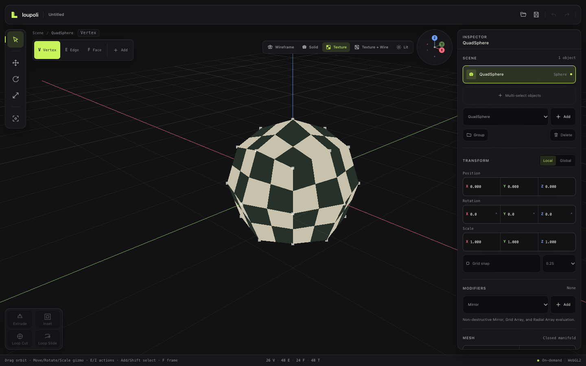

---

## Contents

- [What works now](#what-works-now)
- [UI consistency](#ui-consistency)
- [Getting started](#getting-started)
- [Verification performed](#verification-performed)
- [Deliberately deferred](#deliberately-deferred)
- [Workflow layout](#workflow-layout)
- [iPad layout](#ipad-layout)
- [Planning and architecture](#planning-and-architecture)
- [Project layout](#project-layout)
- [Approved decisions](#approved-decisions)

## What works now

- **Z-up WebGL2 viewport.** `THREE.Object3D.DEFAULT_UP` is set once before scene construction; the custom grid lies on the XY plane.
- **On-demand rendering.** The scheduler draws only for camera, resize, document, selection, or shading invalidation. Headless Chrome measured a stable render count while idle.
- **Camera rig.** Orbit by dragging empty canvas, by Alt/Option-drag, by middle-mouse drag, or with one-finger touch. Two-finger touch pans/pinches, wheel zooms, and the orientation gizmo animates axis-aligned views. No damping loop.
- **Five viewport modes.** Wireframe (true topological edges), Solid (flat-shaded clay), Texture (custom GLSL PS1 path), Texture + Wire (front-only topological overlay over the texture surface), and Lit (flat-shaded checker material). The mode selector now sits immediately left of the orientation gizmo, icon-only on touch layouts and labeled on wide desktop layouts.
- **Local/Global transforms.** Node transforms stay parent-local in the document; the Inspector can display world-space position/rotation and orient translate/rotate gizmos to world axes. Scale remains local to avoid unsupported shear.
- **Context-sensitive Desktop G/R/S.** If vertices, edges, or faces are selected, Grab/Rotate/Scale transform those elements around their median pivot; with no element selection they transform the active object or group. Mouse preview, X/Y/Z constraints, typed exact values, a transform HUD, Enter/click commit, and Escape/right-click cancel are shared. Element transforms are localized vertex moves with their own undo/autosave patches.
- **Selection gizmo on iPad and desktop.** With elements selected, the Move/Rotate/Scale tools place a gizmo at the selection median. Move has X/Y/Z axes plus a free view-plane center handle; Scale has axes plus a uniform center handle; Rotate uses axis rings. Drag with the Pencil or mouse; the object/group gizmo returns when the element selection is empty. Selection stays active after commit.
- **Collapsible sidebar and centered viewport.** On desktop the 3D canvas ends at the inspector's left edge, so the camera, picking, UV split, and HUD center inside the visible modeling area rather than behind the sidebar. The Application Bar control is the only sidebar toggle; there is no redundant sidebar X. Every Inspector section uses the shared `InspectorSection` native `<details>/<summary>`; Scene is open on first run and the rest are closed. Sidebar and section state persist in `localStorage`.

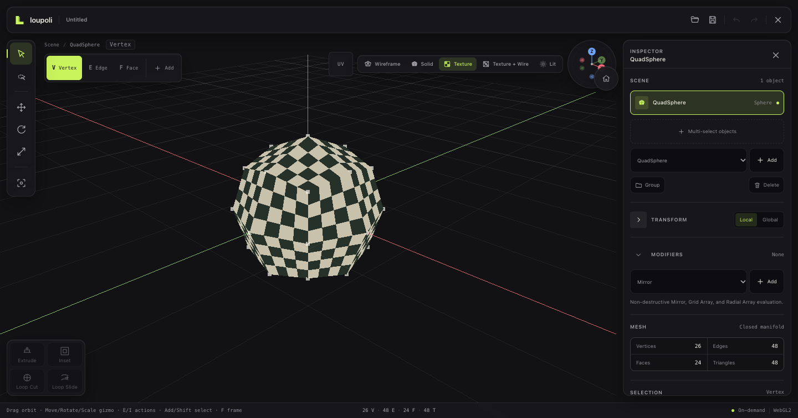

- **ActionDock.** Model-only bottom-left one-shot actions for Extrude, Inset, Loop Cut, and Loop Slide, available on touch and desktop. Tap/click to arm, then drag for a live amount or type an exact amount; Enter/release commits one undoable mesh replacement. Keyboard shortcuts: E extrude, I inset, L loop cut, Shift+L loop slide. Loop Slide is separate from Loop Cut.
- **PS1 is opt-in and tucked away.** Correct perspective mapping and unsnapped geometry are the default. The two independent effects live inside the collapsed **PS1 look** render-effect module at the bottom of the Inspector:
  - **Vertex snapping** — snap vertices to the 320 × 240 PS1 raster.
  - **PS1 affine** — enable affine UV swim.
  Both start off, apply only to Unlit shading, and the module starts collapsed. It is a render effect, not a geometry modifier.
- **General half-edge kernel.** Columnar DCEL with explicit face and boundary loops, per-corner UVs, per-edge seam flags, per-face materials, Newell normals, invariant validation, n-gon fan triangulation, and validated reconstruction from serialized columns.
- **UV seam authoring.** Select edges in Edge mode and use **Seam** to mark or clear UV seams. Seams render as an amber overlay, use one localized undoable command with per-edge autosave patches, and round-trip through `.lpoli`. A UV viewport, seam charts, LSCM unwrap, and linked corner editing are implemented.

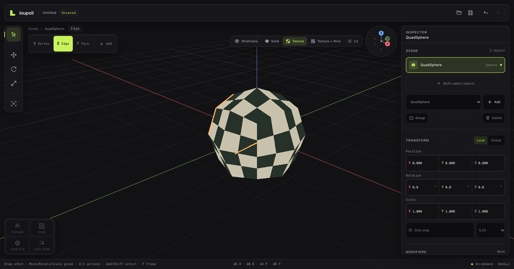

- **Dedicated Paint workspace.** Choose **Paint** in the Workspace Tabs; the 3D stage stays visible while a separate texture-space Paint pane opens. Choose a tool and brush settings from the fixed Paint toolbar and Brush Inspector, then drag the texture. The toolbar includes a live brush-character preview, quick color/size, Fit, and zoom; gradient From and To swatches sit together, and clicking either opens an HSV picker with hue, hex, and alpha. An eye toggle draws a read-only UV wireframe over the texture, with seams emphasized; it is on by default and its state is remembered. Detailed brush settings stay in a stable Inspector section. Brush, eraser, line, rectangle, ellipse, gradient, and fill tools paint into a scratch layer, update the composite texture live in both the Paint pane and 3D view, and commit as one localized pixel-patch command. Committed pixels are not touched until pointer-up; cancel discards the scratch layer. Pen pressure scales brush radius and opacity; pen tilt shapes the stamp into an oriented ellipse. Mouse and touch stamps stay circular. Brush hardness, smoothing, and noise are adjustable. Undo restores the paint rectangle; autosave captures the painted PNG in the next v4 checkpoint. Brush and eraser projection painting are implemented: LMB paints a surface hit, LMB on empty space orbits, MMB/Alt orbits over the mesh, RMB/Space pans, and pen paints without moving the camera. Projected lines, rectangles, ellipses, screen-space gradients, and UV-island fill are implemented, with pen-tilt elliptical brush stamps.

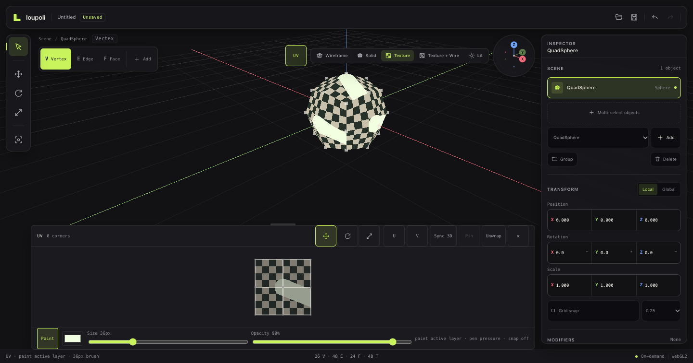

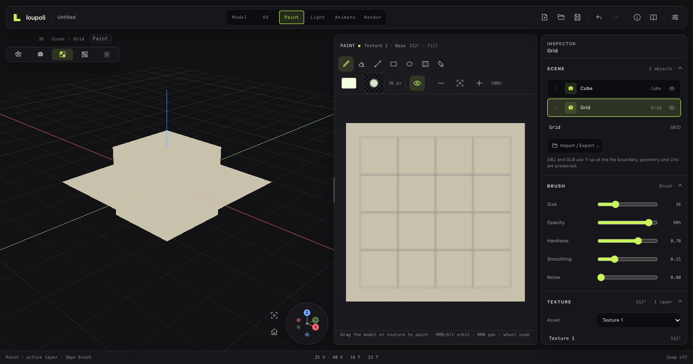

- **Numeric drag-scrub.** Position, rotation, and scale fields support horizontal drag: one pointer pixel is half a step, Shift gives 10× finer control, and release commits one undoable transform. Click to type, Enter to commit, Escape to revert. UV numeric fields share the same control.
- **Brush-size preview.** Paint mode hides the native cursor and draws a circular brush outline at the current texture-pixel size, updated on hover and drag.

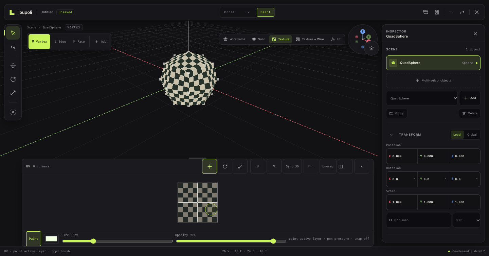

- **Dedicated Light workspace.** Choose **Light** after Paint to light the scene independently of modeling and painting. Directional and point lights plus document ambient drive the Lit viewport. Light markers show their positions; directional markers add a direction arrow. A directional marker position is only an editor anchor; its direction drives the light. Drag the marker to move a light, drag the arrow tip to re-aim a directional light, or select it in the Lighting outliner. The Lighting Inspector handles add/edit/delete and naming with the shared outliner and control system. **Bake lighting** rasterizes direct light into a dedicated multiply lighting layer on the active object’s texture; shared atlases are copied first and overlapping UV islands open the bake-atlas preparation flow. The atlas packs each true UV island as a unit instead of splitting islands across overlap layers, keeps aspect when it enlarges the texture, adds a four-pixel bleed outside each island, and uses closed-shell signed volume for face orientation so concave surfaces bake from the correct side. Creating the unique copy and writing the lighting layer happen in one action. Per-light hard/soft shadows are supported in Lit and in the bake; when UVs overlap, Bake offers to create a duplicate object with a unique, resized bake atlas and resampled layers, leaving the original object and texture intact. AO is deferred. `.lpoli` v4 persists lights and ambient, and reads v3 projects.
- **Shape keys.** Per-node morph targets store absolute vertex positions and 0–1 weights, evaluate beneath the modifier stack, persist in `.lpoli` binary payloads, and import/export glTF morph targets. The Animate Inspector exposes selected-key add/edit/capture/weight/delete controls plus rename, visibility, and drag reordering; key creation and deletion live on the shape weight track in the timeline. Add a key, then either **Edit** its stored target live with the normal mesh tools and Finish, or edit the base and Capture it. Both paths restore the source base and leave the key editable; captured targets can also be keyed into linear/step weight tracks. Key transform records object/group transforms at a timeline frame; shape weights have their own linear/step tracks. The timeline shows an empty transform row for the active object and a row for every shape key, with + Key on each row, selected-key deletion/interpolation, draggable diamonds, adaptive ticks, and wheel/button zoom. Shape key rows support rename, visibility, and drag reordering. Topology replacement is blocked while keys exist. GLB morph import/export is implemented.
- **Dialogs and notifications.** A shared `ModalDialog` owns focused option dialogs and full-space reference dialogs. The application bar provides **About** with the version, author, current license status, and direct open-source licenses, plus a tabbed **Documentation** with workspace screenshots and explanations of the main workflows. `ToastStack` reports import, export, render, save/open, and recovery results above the status bar without blocking the viewport.
- **Model interchange.** OBJ import/export preserves quads, n-gons, per-corner UVs, and simple per-face material colors; both OBJ and GLB export the evaluated modifier result, and OBJ export can target the active object or whole scene and include the assigned composite texture as a PNG beside the bundle. Binary GLB import converts triangle meshes to validated DCEL nodes and preserves UV seams; GLB export is triangulated with indexed primitives, embedded composite textures, simple material names/colors, and node TRS transforms; a Blender 5.1 import was verified. Textured GLB exports use `KHR_materials_unlit` with no metallic response, so baked lighting is not double-lit by a PBR preview; OBJ writes a matte MTL with white Kd and Ks/Ns zero when a texture is present. OBJ’s composite PNG includes baked lighting and must stay beside the MTL; view it in Blender’s Material Preview or Rendered mode, since Solid mode does not display textures. Both file boundaries use Y-up while the document stays Z-up. Imports are undoable batches. External OBJ texture-map import, glTF textures/skins/animations, and richer material exchange remain future work.
- **Animation workspace.** Choose **Animate** after Light to key object/group transforms at integer frames. The bottom timeline has play/pause, scrubbing, track rows, and key diamonds; the Animation Inspector controls FPS, range, looping, interpolation, key insertion/deletion, and track selection. Playback uses an explicit scheduler only while playing, and preview poses stay separate from rest transforms. Animation is saved in `.lpoli`. Camera/light animation remains future work; shape keys and shape-weight tracks are implemented.
- **Camera and Render workspace.** Project cameras are saved with transparent, named position/target/FOV data. Choose **Render** after Light to compose through the active camera in free camera editing, with the grid available for navigation, and render a clean PNG at an explicit virtual resolution, upscaled to the output resolution with nearest or smooth filtering. The Render Inspector controls virtual/output size, upscaling, shading, transparency, and background, plus the compact Frame/From view/Through actions. The camera frustum follows the virtual aspect, while non-proportional output dimensions letterbox the preserved virtual frame rather than stretching it. Cameras have their own outliner list with editable names and FOV. Render is a free camera-editing view with orbit/pan, a camera frustum and draggable body/target handles, plus a camera arrow. View through/Exit view temporarily looks through the render camera and hides its handles; orbit/pan/zoom returns to free editing. Render output is color-managed and excludes editor helpers. The Camera inspector uses the shared camera list and exposes editable names, position, target, and FOV; View through/Exit view toggles the clean camera view and hides helpers. The always-open preview pane uses the same PaneHost and PaneFrame as UV and Paint, renders live through the active camera whenever the camera or scene changes, and provides play/pause for animation. Frame sequences and WebM/MP4 export are implemented; native MP4 encoding remains future work. AO remains deferred.
- **Texture assets and bindings.** A project-level texture library owns independent assets with arbitrary dimensions up to 4096 px and the texture pixel budget, plus 64–4096 presets, nearest/linear filtering, and up to eight layers each. Custom width and height keep any proportion; presets are shortcuts. Meshes bind to assets by stable ID, so several objects can share one low-poly atlas. The Inspector exposes a compact asset header with a shared inline name field, New/shared overflow actions, stateful assignment, filtering, alpha mode, a typed Add-layer menu, and a selected-layer properties panel. Layers can be solid, checker, transparent, or raster. Each asset has one composite `CanvasTexture`, and the renderer caches material variants per asset so shared textures upload once. Paint transactions keep committed pixels untouched until commit and store one localized undo rectangle. Layers carry color/detail/lighting roles for the future bake pipeline and save as binary PNG chunks in `.lpoli` v4; texture edits are captured by v4 autosave checkpoints. Layer rename and Normal/Multiply/Screen blend modes are implemented and persisted. Layers carry color/detail/lighting roles for the future bake pipeline. Imported images become fitted raster layers with preserved aspect ratio. Checker is a preview backdrop; transparent texels preserve composite alpha, and assets can render as Opaque, Cutout, or Blend in 3D. Raster layers stay authoritative through opacity/blend/rename undo and save as PNG chunks; a raster brush paints the active asset layer directly in the UV view, and Brush/Eraser projection-paint the active object's bound asset in 3D.

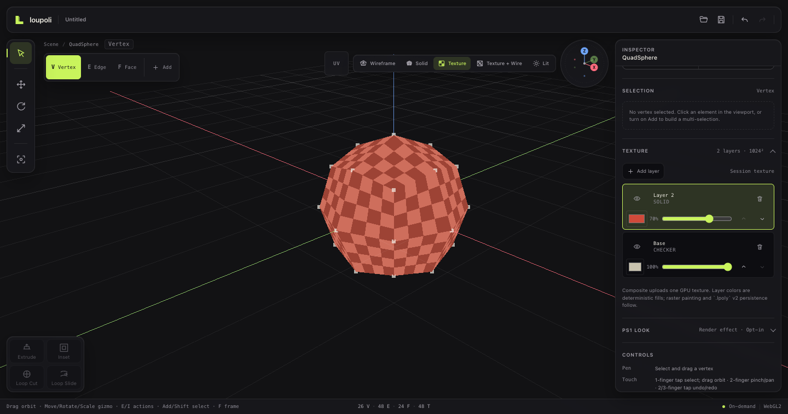

- **UV unwrap.** **Unwrap** extracts charts across seam edges and open boundaries, splits corner fans at seams so pinched nets remain valid, runs a dependency-free LSCM solver, aligns each chart, and packs it into a deterministic shelf. Closed charts fail with an explicit "mark a closed seam loop" message; collapsed or flipped UV triangles are rejected instead of applied. The operation replaces per-corner UVs in one undoable command with an autosave patch. Two selected corners can be pinned; otherwise the solver chooses the farthest boundary pair. Collapsed, flipped, and overlapping triangles are rejected. Pins are session-only.

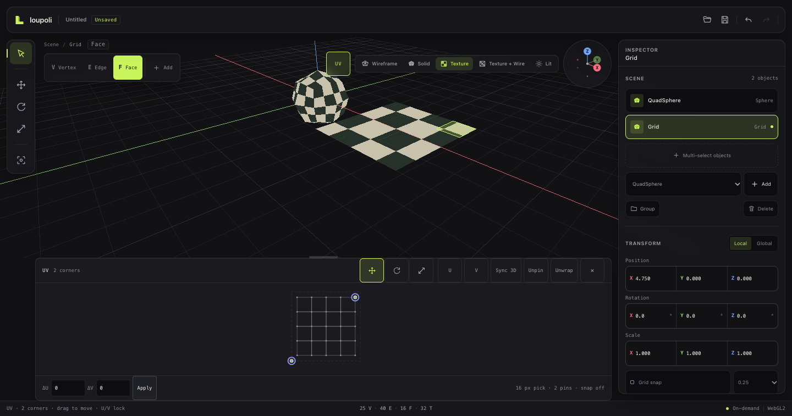

- **UV and Paint workspaces.** Use the TopBar **Model / UV / Paint** switcher. UV opens a side-by-side chart editor; Paint opens a separate side-by-side texture-paint pane. The PaneHost divider resizes either pane. UV operations (U/V, Sync, Pin, Unwrap, Stack) and View (zoom out, Fit, zoom in, Clamp) live in the UV header. Move/Rotate/Scale and V/E/F/Island are contextual: the left tool rail and top-left selection control drive both 3D and UV, and are hidden while Paint owns the active editor.

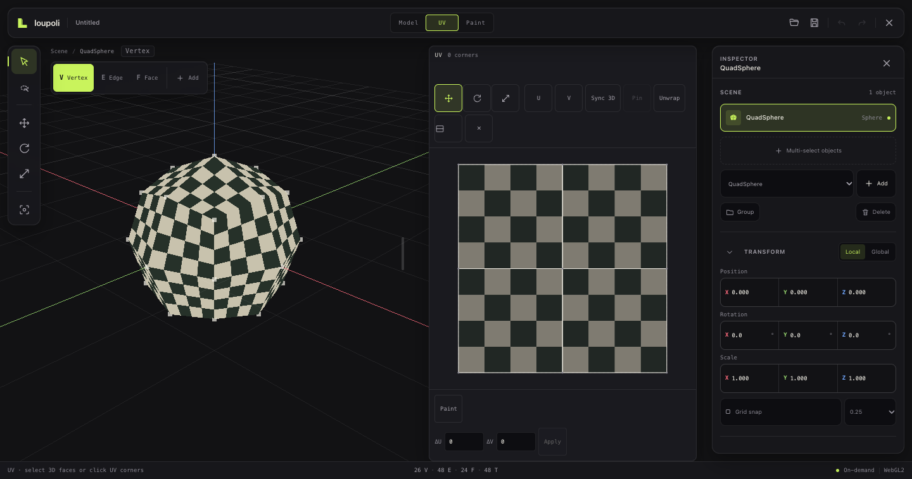

- **UV editing split.** Selecting 3D faces feeds their corners into the UV view; the **Sync 3D** action refreshes that link. Click corners with the 16 px pick radius; in Island mode clicking anywhere inside a chart selects and drags the whole island. Mouse wheel zooms around the pointer, right/middle-drag pans, dragging empty UV space pans, and the View group provides 44 px zoom/Fit controls. Direct transforms clamp to the 0–1 texture square while Clamp is enabled; Clamp is off by default because the clamped edge can change during rotation and cause jumps. Rotate follows the pointer angle around the UV median; Scale follows pointer distance from that pivot, so moving around it keeps scale unchanged. **Mirror stack** stacks a reflected island with an explicit mirrored correspondence for symmetric albedo and painting. **U** and **V** lock Move/Scale to one axis; grid snap applies to UV increments and rotation snaps to 15° when enabled. Exact **ΔU/ΔV**, **angle°**, and **scale factor** fields apply without snapping. Each transform is one undoable command with per-corner autosave patches, and the split is resizable with the grip above the panel. Selecting UV corners also highlights the owning 3D faces without expanding the precise UV corner set. Texture layers, LSCM unwrap, a texture-space Paint workspace, and Brush/Eraser and projected line/rectangle/ellipse/gradient/fill painting are implemented.

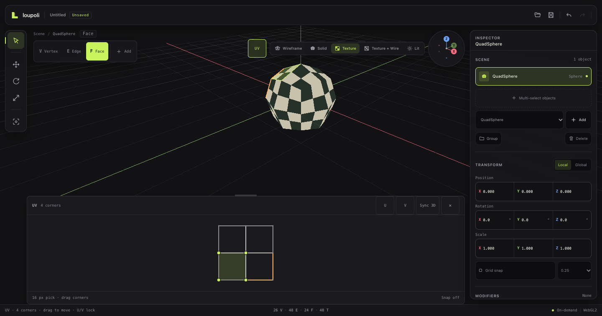

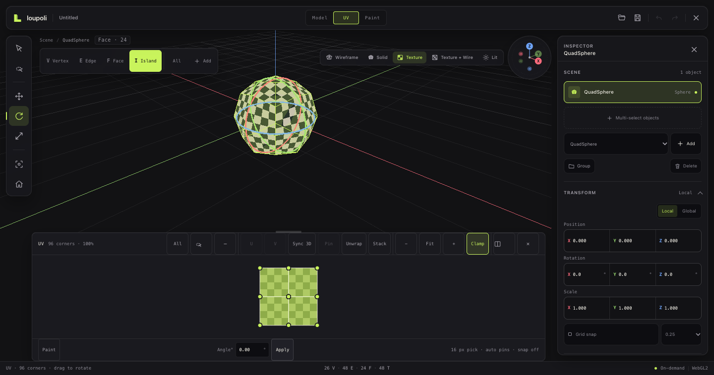

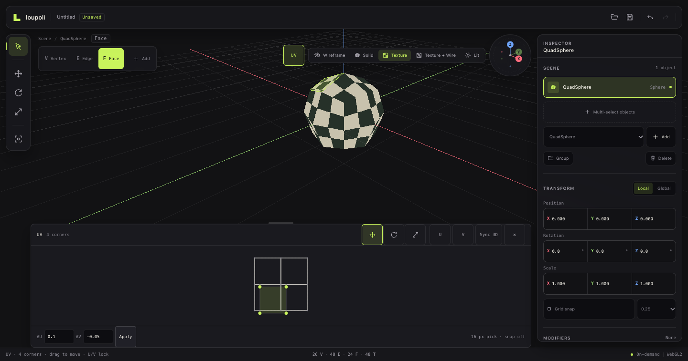
- **Four real primitives.** QuadSphere (all quads), Cube (all quads), Cylinder (quad wall plus n-gon caps), and Grid (open surface with explicit boundary loops). The first-run scene and New Project both contain an editable Cube.
- **Multi-object scene.** Add primitives from the inspector, select the active object in the Scene outliner, delete it through an undoable command, and keep working with the same selection mode. New primitives are placed at the world origin and immediately selected; they may overlap existing objects until moved. New Project uses a default Cube and resets document/history/UV state. Outliner rows have a drag handle for pointer/touch reordering and a 44 px eye toggle; both reorder and visibility are undoable and journaled. Multi-select is a compact action beside Group, Join, and Delete.

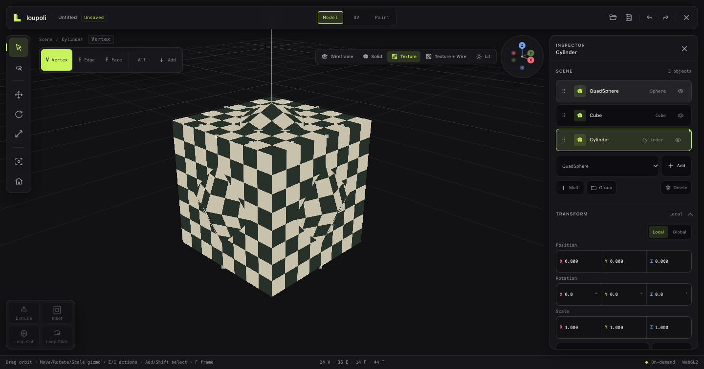
- **Numeric object transforms.** Position, rotation (degrees in the UI, radians in the document), and scale rows in the Inspector commit undoable `TransformNodeCommand`s. Transforms are local object transforms and persist in `.lpoli` and autosave deltas.
- **Object/group transform gizmos.** With no element selection, Move/Rotate/Scale show object-space handles. Dragging an axis commits one `TransformNodeCommand`; mouse and pen are supported, while finger touch remains camera navigation.
- **Consistent edge overlays.** Selected edges use constant-width instanced tubes rather than length-scaled radius, so cube and QuadSphere selections have comparable weight. Wireframe and Texture + Wire add instanced tubes for a heavier, readable line without replacing the DCEL edges.
- **Selection loops and seam cleanup.** In 3D Edge mode, **Loop** selects the connected quad edge loop from the clicked edge. Open boundaries continue along the boundary; poles and non-quad junctions stop the walk. The Selection inspector can clear every seam on the active mesh in one undoable command. ActionDock is hidden while the UV split is open because it owns 3D topology actions.
- **Stable UV view.** The pane caches its fitted projection while transforming and only refits on open, resize, or **Fit**. Scale uses a damped pointer-displacement factor with a live × readout, so scaling cannot run away when started near the pivot.
- **Default UV seams.** New primitives start with practical seams: Cube uses three two-face strips, QuadSphere uses six patch charts, Cylinder separates both caps and cuts the side into two strips, and Grid remains unseamed. Charts are corner-based, so authored pinched nets also unwrap correctly; seam overlays are depth-tested so back-facing cuts stay hidden.
- **Element selection and overlays.** V/E/F selection uses a 16 CSS px screen-space tolerance with occlusion rejection; faces use a front-face raycast mapped back to source DCEL faces. Shift/Cmd/Ctrl-click, the sticky **Add** toggle, and one-finger touch taps build a set. Shift-drag orbits on empty space, so additive selection and camera movement work together. Selected vertices, edges, and faces render distinct overlays. Replace/Add/Subtract applies to clicks and lasso in both 3D and UV. Selection changes are undoable but remain session-only and are never written to `.lpoli` or autosave.
- **Lasso selection.** The Lasso tool draws a screen-space polygon and selects vertices inside it, edges inside or crossing it, and faces with a corner or centroid inside. It works in the active V/E/F mode, supports the sticky Add toggle, and is available to mouse, Pencil, and one-finger touch. Lasso selection is view-through in Wireframe and occlusion-aware in every shaded mode; back-facing/covered vertices, edges, and faces are rejected.

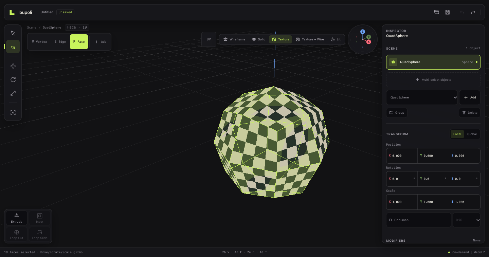

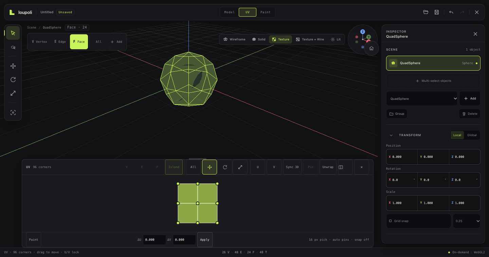
- **Draggable view gizmo.** Dragging the orientation gizmo orbits the view; tapping an axis still snaps to that axis and tapping the center frames the active object.
- **Quad-aware deformation.** A bent quad renders as a 4 × 4 bilinear patch instead of two independent texture panels, avoiding a diagonal texture crease. The DCEL remains one quad, and displayed V/E/F/triangle counts stay topological.
- **Bounded command history.** Localized vertex deltas and node add/delete snapshots, redo truncation, a 100-command cap, and a 32 MB retained-byte budget.
- **Local-first autosave.** A v4 checkpoint (including texture asset PNGs and lighting) plus localized command deltas is written to IndexedDB every 30 seconds while dirty and on visibility loss. Texture edits force a fresh v4 checkpoint on the next flush. Cold start offers **Recover** or **Discard**; recovered work is labelled until saved.
- **Versioned `.lpoli` v4.** Binary container with a CRC-checked manifest and aligned typed-array columns. It round-trips nodes, quads, n-gons, boundary loops, per-corner UVs, seam flags, face materials, transforms, node texture bindings, viewport settings, and a texture asset library with per-layer binary PNG chunks. v3 files remain readable; existing `.lpoly` files open normally and are saved with the primary `.lpoli` extension next time. Legacy v1/v2 compatibility is deferred until the MVP.
- **Native and browser file I/O.** Tauri uses the native dialog plugin plus Rust byte-level read/write commands with size checks, same-directory temporary files, `fsync`, and rename. Browser mode uses download and file-picker fallbacks. `Cmd/Ctrl+S` and `Cmd/Ctrl+O` are wired.
- **Pointer routing.** Pen never moves the camera; it selects, drags selection/action gizmos, and edits vertices. Touch remains the camera/gesture surface, with taps selecting and one-finger drag orbiting. Mouse supports the documented DCC orbit mappings.
- **Design system.** Vanilla CSS tokens, local icon registry, floating glass panels, responsive iPad portrait/touch layouts, 44 px touch targets, documented action-size tiers and bottom-HUD offsets, focus states, safe-area handling, and reduced-motion/reduced-transparency fallbacks.

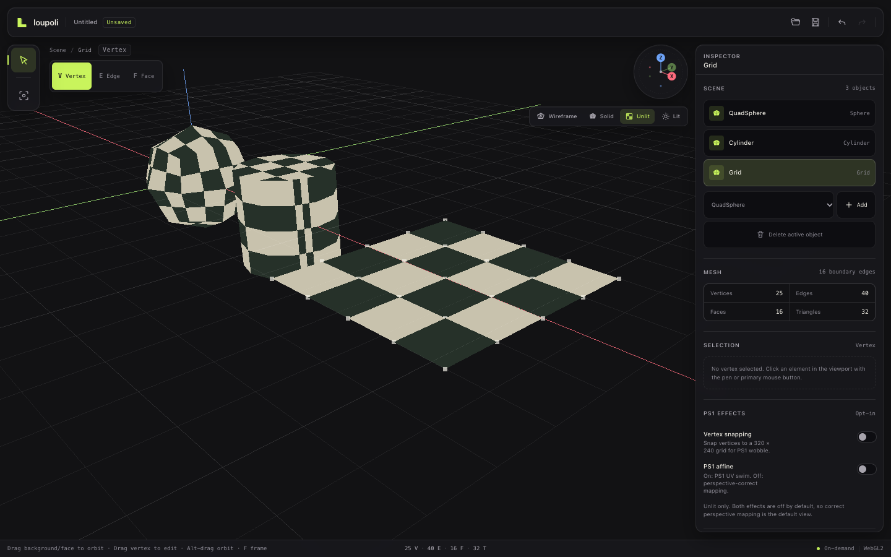

Edge and face selection are real topology selections, not render-only triangles:

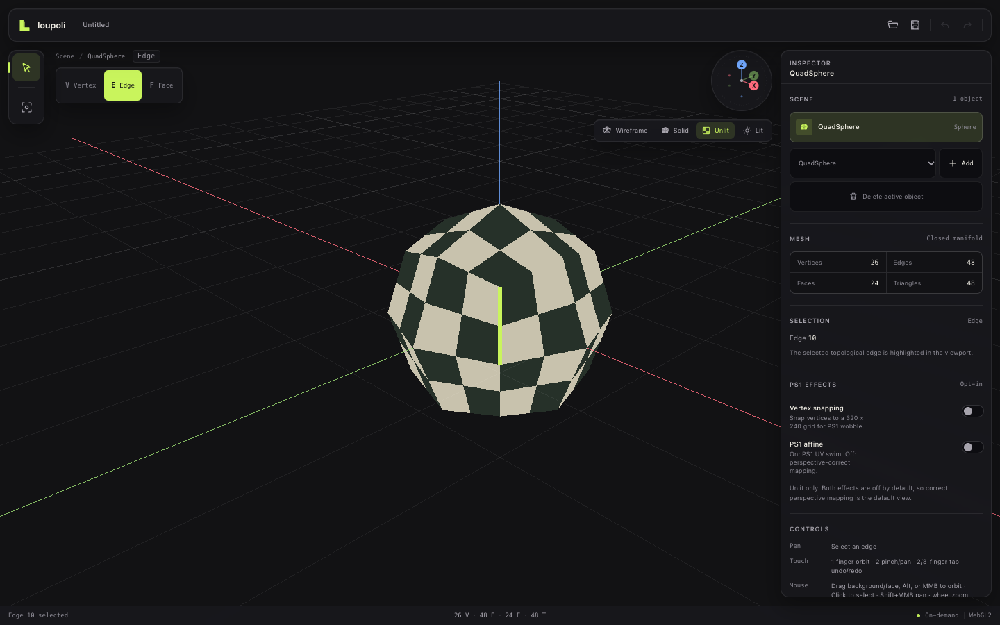

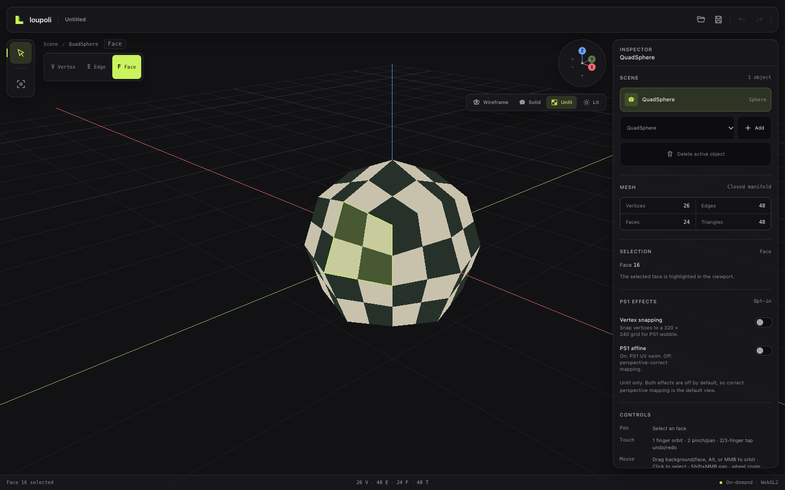

Additive multi-selection, using the sticky Add mode. Selected vertices, edges, and faces each get their own overlay:

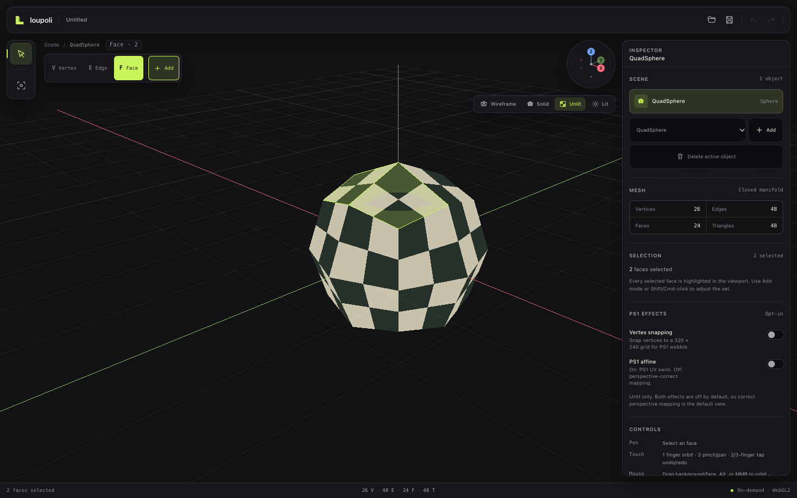

Object transforms are available as local position, rotation, and scale fields with undo:

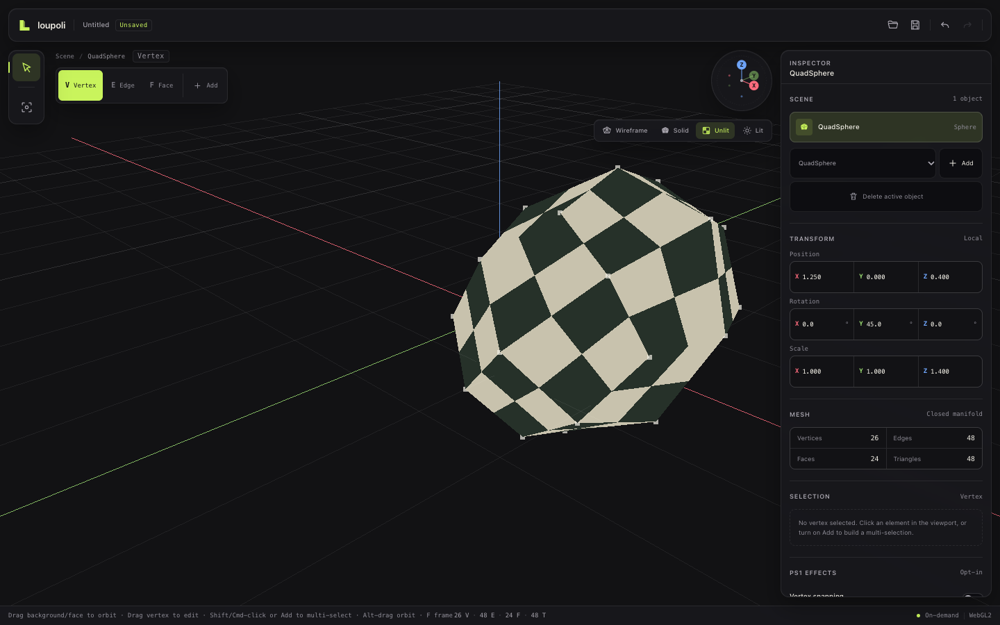

The Move tool's object-space gizmo. Rotate and Scale swap the handles for the same active object:

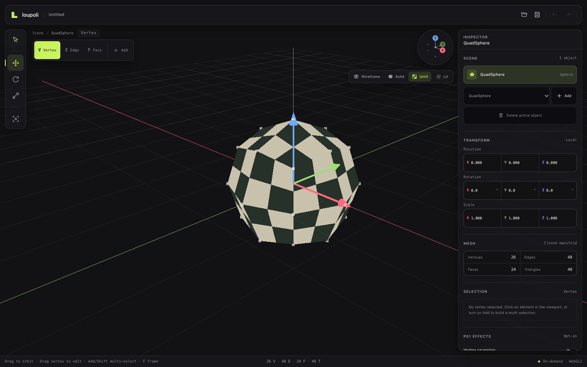

Deleting two faces creates real boundary loops; the PS1 render-effect module is collapsed by default:

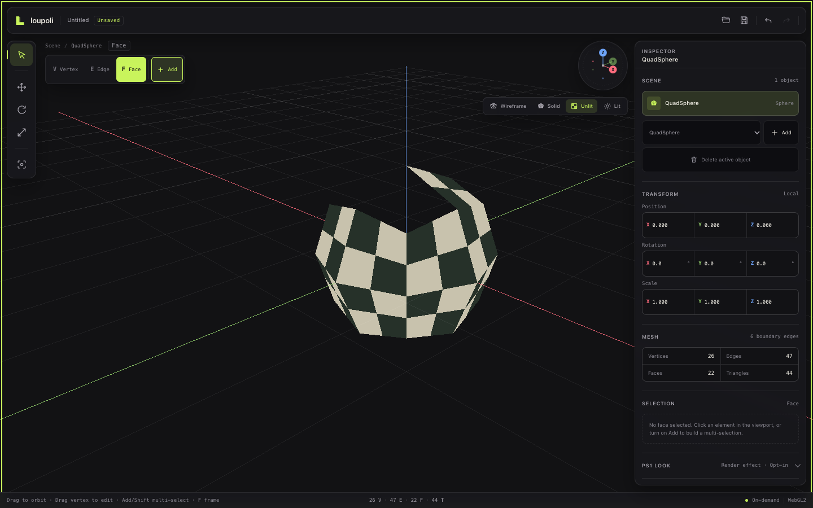

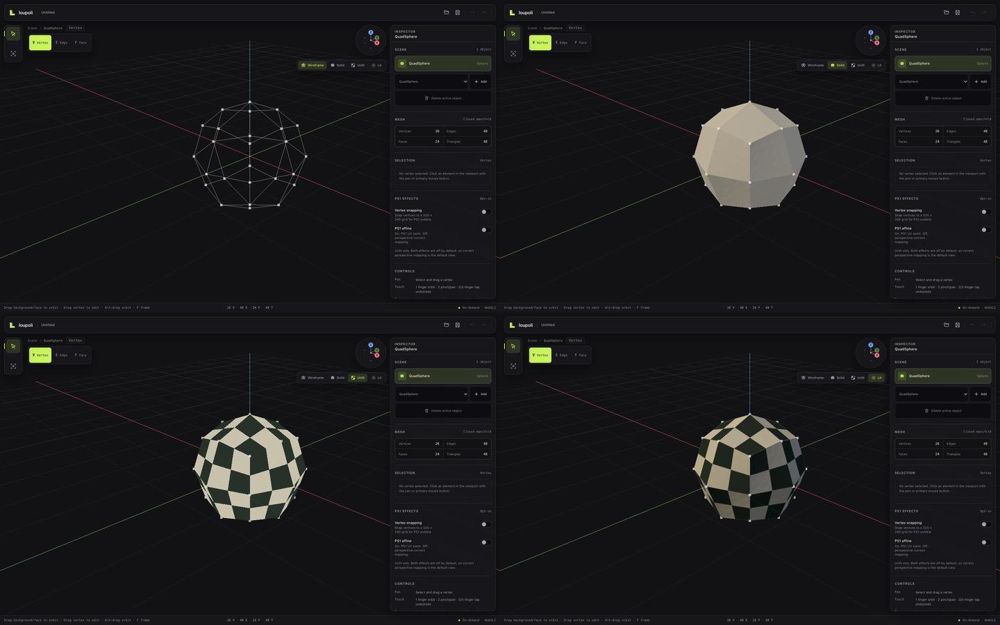

The updated top-right view control, with Texture + Wire in the fourth slot:

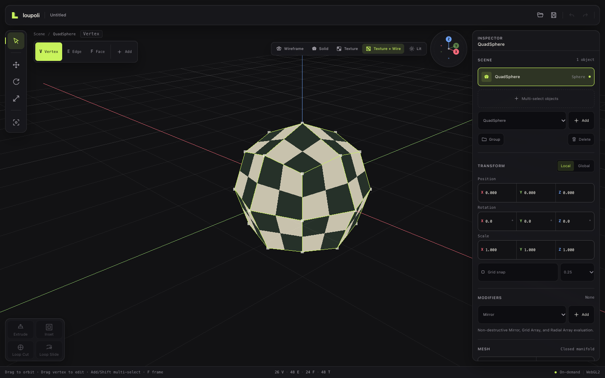

Default and opt-in PS1 comparison, same camera position:

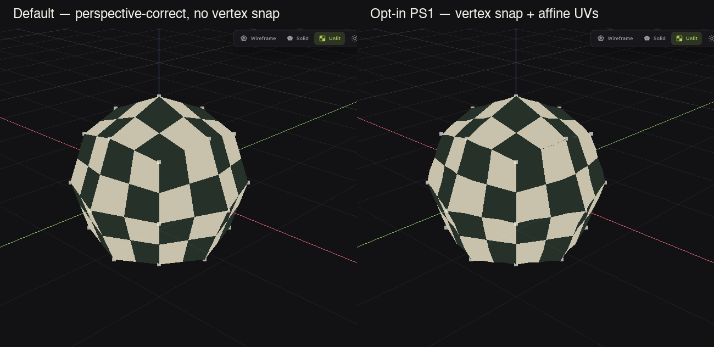

The autosave recovery flow is explicit and non-destructive:

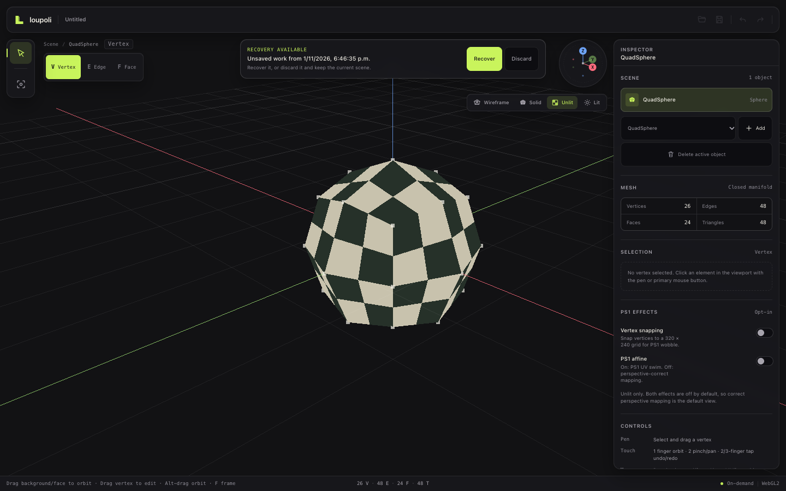

---

## UI consistency

UI consistency is part of the product contract. The canonical behavioral rules live in [UI rules §9](./docs/UI_RULES.md#9-shared-ui-contracts); visual tokens and component shapes live in the [Design System](./docs/DESIGN_SYSTEM.md). Do not duplicate them in feature docs.

## Getting started

Requirements: Node.js ≥ 22.12 (tested on 26.12), Rust ≥ 1.90 (tested on 1.94), npm, and macOS/Xcode for the Tauri desktop shell.

```bash
npm install
npm run dev          # browser development at http://localhost:1420
npm run tauri dev    # native desktop shell
npm run check        # svelte-check + strict TypeScript
npm run build        # production frontend
npm test             # DCEL, scene/history, journal, and .lpoli tests
```

Native file dialogs are provided by the Tauri dialog plugin; there is no second web server for browser mode. The iOS project has not been initialized yet.

### Controls

| Input | Action |
|---|---|
| Pen | Select a vertex, edge, or face in the current mode. In vertex mode, drag the selected vertex. Pen never moves the camera. |
| Mouse LMB on a topology element | Select it, or drag it in vertex mode. |
| Object row click | Make that object active. Shift/Cmd/Ctrl-click toggles multi-selection; the sticky **Multi-select objects** toggle does the same for pen/touch. |
| Group row click | Select the group for numeric or gizmo transforms. Group children stay editable from the indented outliner rows. |
| X/Y/Z while a vertex is selected | Toggle a world-axis lock for the next vertex drag. 44 px X/Y/Z chips provide the same control for pen/touch. |
| Grid snap toggle/step | Snap object translation and vertex drags to the selected 0.1–1.0 step. |
| Move/Rotate/Scale handle | With an element selection, the gizmo sits at the selection median and drags the selected elements; otherwise it transforms the active object/group on that axis. Pen/mouse; one-finger touch remains camera navigation. |
| Texture + Wire | Texture surface plus a front-only topological wire overlay. Back edges are depth-occluded. |
| ActionDock | Tap/click Extrude, Inset, Loop Cut, or Loop Slide to arm it. Drag up/right to set the amount; release applies. Type an exact amount then Enter; Esc cancels. |
| E / I | Arm Extrude / Inset for the current face selection. |
| L / Shift+L | Arm Loop Cut for one selected edge / Loop Slide for the most recent loop cut. |
| Type a number during an action | Exact amount: units for Extrude, percent for Inset and Loop position. Enter applies. |
| Shift, Cmd, or Ctrl + click | Add or remove an element from the current selection. |
| Right-drag | Pan the view. |
| Lasso tool + drag | Select a screen-space region in the current element mode. |
| Add toggle | Sticky additive selection for pen, mouse, and touch taps. |
| Touch tap / drag | One-finger tap selects the current V/E/F element; drag orbits unless the Lasso tool is active. With Add on, taps toggle the set. |
| Mouse LMB on empty canvas or a mesh face away from a handle | Orbit the camera. |
| Alt/Option + LMB | Orbit. Useful for trackpads and one-button mice. |
| Alt/Option + Shift + LMB | Pan. |
| Mouse MMB | Orbit. |
| Shift + MMB | Pan. |
| Lasso / touch drag | Lasso works with mouse, Pencil, and one-finger touch when the Lasso tool is active. |
| Mouse wheel | Zoom. |
| One-finger touch | Orbit. |
| Two-finger touch | Pinch to zoom; drag to pan. |
| Two-finger tap | Undo. |
| Three-finger tap | Redo. |
| Cmd/Ctrl+Z | Undo. |
| Shift+Cmd/Ctrl+Z, Ctrl+Y | Redo. |
| Cmd/Ctrl+S | Save the project. |
| Cmd/Ctrl+O | Open a project. |
| G | Start a modal move of the active object or group. Move the mouse to set the offset. |
| R | Start a modal rotate. Without an axis constraint, rotation follows the pointer angle around the object pivot; moving counterclockwise on screen rotates counterclockwise. |
| S | Start a modal scale. Without an axis constraint, scaling is uniform and follows the pointer distance from the object pivot. |
| X / Y / Z during G/R/S | Constrain to an axis. Pressing the same axis again clears the constraint. |
| Type a number during G/R/S | Exact amount: units for move, degrees for rotate, factor for scale. Move requires an axis constraint. |
| Enter / left click | Commit the modal transform. |
| Escape / right click | Cancel the modal transform and restore the previous pose. |
| F | Frame the active object. |
| Escape | Cancel the active drag or modal transform, or close the mobile inspector. |
| Orientation gizmo | Drag to orbit. Click a bright `+X/+Y/+Z` or darker `−X/−Y/−Z` endpoint to view that side. Click the center to frame the active object. Use the toolbar Home button or `Home` to reset to Blender Front (camera on −Y). |

Selection modes are switched with the **Vertex / Edge / Face** control at the top-left of the viewport. The Scene outliner selects the active object; picking always edits that object.

---

## Verification performed

- `npm run check`: 0 errors, 0 warnings.
- `npm test`: **126 passing** tests across thirty-one files:
  - DCEL invariants, outward winding, boundary loops, open-grid topology, and adaptive quad tessellation.
  - QuadSphere, Cylinder (n-gon caps), and Grid construction.
  - Default seam profiles for Cube, QuadSphere, Cylinder, and Grid.
  - Localized vertex moves, add/delete commands, 100-edit history restoration, and the byte/command budget.
  - `.lpoli` multi-node round-trips (including open boundaries, seam flags, materials, and byte-for-byte re-encoding), corruption rejection, and empty-scene support.
  - Journal patch replay from a checkpoint, and a randomized 80-step add/delete/move/undo/redo sequence that validates every remaining mesh.
  - Scalar grid-snap rounding and axis-projection math.
  - Group creation/transform/ungroup undo and journal replay, plus group/parent round-trip through `.lpoli`.
  - Mirror clipping/winding/seam closure, grid repetition, radial repetition, modifier-stack persistence, stack edit journal replay, and evaluated-element provenance.
  - Single-face extrusion, multi-face region extrusion with boundary walls, single-face inset closure/topology, multi-segment closed-loop bridging, and quad-loop cuts on closed/open meshes.
  - Face/vertex/edge deletion, boundary regeneration, UV/material preservation, delete-every-face rejection, and deletion command/journal replay.
  - Vertex merge to centroid, collapsed-face cleanup, two-boundary-edge bridging, and invalid-selection rejection.
  - Object join with transformed source baking, target pivot preservation, undo/redo, and multi-patch journal replay.
  - Multi-element selection replacement, additive toggling, duplicate suppression, pruning, and mode/node context clearing.
  - Object transform command execution, undo/redo, autosave journal replay, `.lpoli` transform persistence, and gizmo axis/angle/parameter math.
  - Multi-vertex transform command execution/undo and localized move-vertex journal patches.
  - Loop cut positioning across a 0–1 slide range, with topology validation.
- `cargo test --manifest-path src-tauri/Cargo.toml`: 3 passing Rust tests for envelope/CRC validation, atomic project write/read, and missing-directory rejection.
- `npm run build` succeeds on Vite 8 / Svelte 5.
- `npx tauri build --debug --no-bundle` compiles the desktop shell, dialog plugin, and file commands.
- Headless Chrome WebGL2 smoke tests:
  - Desktop, iPad portrait, and iPad landscape layouts with no horizontal overflow.
  - Idle render count stable before/after a 1.2 s window.
  - Vertex, edge, and face picking; 16 px vertex threshold; single and multi-element overlays visible.
  - Multi-select via Shift-click and the sticky Add mode on both mouse and pen input; deselect-on-toggle and empty-click clearing verified.
  - Numeric position/rotation/scale commits, undo/redo, and orientation-gizmo drag orbit verified with a stable idle render count.
  - Move/Rotate/Scale gizmo handle picking and axis-constrained drags committed, undone, and verified on desktop and emulated iPad; all tool buttons remain 44 px+ targets.
  - Face, vertex, and edge deletion through the Selection panel and Delete/Backspace, with undo and live boundary-count update; no console errors.
  - PS1 effect module collapsed by default, expansion tested, and both toggles still function.
  - Merge selected vertices and bridge two boundary edges through the Selection panel, with undo and updated boundary counts.
  - Multi-object selection by modifier-click and the sticky toggle; joining sphere, grid, and cylinder objects into the active target, with validated topology and undo/redo.
  - Grid snap at 0.5 verified for object translation and vertex movement; Y/Z coordinates stayed untouched under X-axis lock; keyboard axis locking and 44 px iPad axis chips verified.
  - Grouped two objects, preserved their world centers, transformed the group numerically and with its gizmo, selected a child and edited its local position, then ungrouped with world centers preserved and undid it. Group tree rows/actions are 44 px on iPad.
  - Added, reordered, toggled, edited, and removed modifiers through the Inspector; evaluated counts updated live, reordering changed the result, invalid stacks surfaced errors, and all modifier controls are 44 px on iPad.
  - One-finger touch taps selected and toggled vertices with Add mode, multi-vertex overlays updated, empty taps cleared, and one-finger drag still orbited. Two/three-finger gesture paths remain unchanged.
  - Arrayed/mirrored picking mapped evaluated faces/vertices back to base indices; selected vertices highlighted on both array copies, selected faces highlighted on both copies, and disabling the modifier reduced the overlay to the single base element.
  - Extrude and Inset through the Selection panel; counts rose to 30 V/56 E/28 F after a single-face operation, multi-face extrusion reached 32 V/60 E/30 F, the rebuilt meshes validated, and both actions were 44 px targets.
  - With Grid Array active, deleted and extruded provenance-selected base faces: base/evaluated counts updated together, the stack stayed active, undo restored the base mesh, and no errors were logged.
  - With Grid Array active, dragged an evaluated vertex: its base vertex moved through the inverse per-copy transform, both evaluated copies updated, the stack stayed active, and undo restored the base position.
  - Loop-cut one sphere edge: 24 F/26 V became 32 F/34 V with a closed, valid quad ring; repeated under an active Grid Array and produced 64 evaluated faces.
  - Texture + Wire rendering, top-right placement, icon-only touch density, compact scene/selection actions, and Texture + Wire `.lpoli` settings round-trip verified. The wire pass now culls back-facing edges on the CPU: the default sphere drew 28 of 48 edges and a cylinder drew 23 of 36, with the back wall absent.
  - Loop-cut preview: while dragging a Loop Cut, a solid blue loop line marked the prospective cut; it cleared on commit/cancel and remained distinct from the lime front wire. Loop context survived undo/redo of the cut and slide (t 0.65 → 0.3 → 0.65) and cleared after an unrelated transform.
  - Seam authoring: edge selection toggled an amber seam overlay; undo restored the DCEL flags, autosave journal patches reapplied them, and `.lpoli` round-tripped the flags.
  - UV split: a selected face produced four linked UV corners; clicking a UV corner highlighted its owning 3D face while keeping the single-corner UV selection, and changing the 3D face refreshed all four UV corners. Dragging moved all four under one `Move 4 UV corners` command, undo restored them, U-lock changed only U, and snap produced a 0.25 UV increment. Rotate and Scale drags produced their own commands and pivoted around the UV median. Exact numeric ΔU/ΔV, 90° rotation, and factor 3 produced exact UVs; the scale field initially exposed a native step-validation bug that blocked submission, fixed by using `step="any"`. The split resized from 38% to 50%, 3D selection changes refreshed the linked corner set, and closing restored the full 3D viewport and ActionDock. Unwrapping the open grid produced an axis-aligned 4×4 UV grid, one undoable `Unwrap UVs` command, and finite packed UVs; two selected corners pinned the solve with visible pin markers. Unwrapping the closed sphere surfaced "A closed UV chart has no boundary. Mark a closed seam loop before unwrapping." After the canvas-only resize fix, the camera aspect tracked the split (3.070 measured vs 3.068 expected) and returned to 1.902 on close. Idle renders stayed flat with the UV view open (5 → 5) and closed (7 → 7).
  - Global orientation on a grouped, rotated child: world fields showed the composed pose, the move/rotate gizmo axes were world-aligned, global position/rotation edits converted back to local coordinates, and undo restored the prior pose.
  - Modal G/R/S: free mouse move, X-axis constrained typed move, 45° typed rotation, 2× typed scale, click confirmation, axis toggle, and Escape cancellation were exercised; each commit produced one transform command and undo restored the pose.
  - ActionDock: touch tap armed Extrude; a pencil/mouse drag previewed and committed 30 V/56 E/28 F from 26/48/24; touch targets measured 44 px; Inset matched those closed counts; Loop Cut produced 34/64/32 and enabled Loop Slide; Loop Slide produced a valid 34/64/32 mesh; cancel restored mesh and selection; a Grid Array-evaluated base extrude updated 28 base faces to 56 evaluated faces.
  - Desktop action shortcuts: E + typed `0.5` + Enter extruded exactly 0.5; I + `20` produced a 20% inset; L + `30` created a loop at 30%; Shift+L + `65` slid it to 65%; the resulting mesh validated. The ActionDock and ActionHud were visible at 1440 px, and the touch layout still measured 44 px.
  - Element G/R/S: a selected face moved +0.5 local X while the object transform stayed at zero and the face selection remained active; two faces rotated 30° around their combined median; undo restored geometry. With Grid Array active, the same base-face move kept 26/48/24 base counts and 52/96/48 evaluated counts, validated the base mesh, and undid cleanly; the HUD labelled the target `1 face (base)`.
  - Selection gizmo: on desktop and emulated iPad, a selected face showed the gizmo at `[-0.401, -0.401, 0.935]` (the face median). Dragging X committed Move/Rotate/Scale vertex commands with the object position still zero and the face selection retained; undo restored each. With no selection the same tool dragged the object; with Grid Array active it edited the base median and re-evaluated to 52/96/48. iPad tool targets were 64×52 px.
  - Front-only Texture + Wire: a solid PS1 surface occluded back-wall wire edges on a cylinder while front edges remained visible.
  - Per-copy modifier linear maps round-tripped through their inverses for Radial Array geometry, covering mapped base-vertex editing.
  - Vertex drag through the real DCEL, undo, redo, and teardown without console errors.
  - Primitive creation, outliner selection, deletion, and undo/redo.
  - PS1 effects default off; enabling both produces snapping/UV swim.
  - Touch orbit while the non-modal iPad inspector is open.
  - Autosave flush, simulated reload, recovery banner, Recover/Discard, and structural (node add/delete) journal replay.
  - Browser save produced a valid `.lpoli`; browser open through a file input restored the saved two-node scene.
  - No application console warnings or exceptions.
- Screenshots in `docs/media/` were captured from the running app at the current UI revision.

Not yet verified:

- The native macOS WKWebView window has not been visually smoke-tested. The Rust shell and frontend production build are validated separately.
- Physical iPad performance, palm rejection, and native iOS file dialogs still require the iOS packaging pass.
- Browser cancel semantics depend on `input.cancel` or the window-focus fallback; Tauri uses its native dialog.

---

## Deliberately deferred

- Nested groups and rename/reparent controls beyond the current one-level groups.
- Direct base vertex dragging while the modifier stack is active (destructive topology actions and provenance selection work now).
- UV viewport and transforms, chart extraction/LSCM unwrap, texture layers, and projected painting are implemented. Phase 4 has a [conditional exit audit](docs/PHASE4_AUDIT.md); multi-angle tolerance, physical-iPad memory, and texture pixel deltas remain follow-ups.
- Phase 5 follow-ups: AO, shape keys/timeline, and OBJ/GLB import/export.
- Touch element dragging. Touch taps select; one-finger drag remains camera orbit.
- Camera state and active-object selection are not stored in `.lpoli` yet; node transforms and viewport settings are.

Phase 3 topology polish and Phase 4 texturing are feature-complete. [Phase 4 has a conditional exit audit](docs/PHASE4_AUDIT.md). Phase 5A lighting, per-light hard/soft shadows, and direct-light texture baking are implemented; AO, shape keys, and interchange remain.

---

## Workflow layout

- Shading/rendering modes live in a compact segmented control immediately left of the orientation gizmo.
- Touch layouts show 44 px icon-only mode buttons; wide desktop layouts show labels.
- Secondary scene actions (**Group**, **Join**, **Ungroup**, **Delete**) are a compact wrapped row rather than full-width bars.
- Selection actions use compact icon-and-label chips; full-width controls are reserved for primary actions such as Add.
- Touch controls keep 44 px hit areas even when their visual footprint is reduced.
- The Transform header switches between Local and Global. Global space is useful for grouped children: the numeric fields and move/rotate gizmo use world axes while the stored node transform remains parent-local.

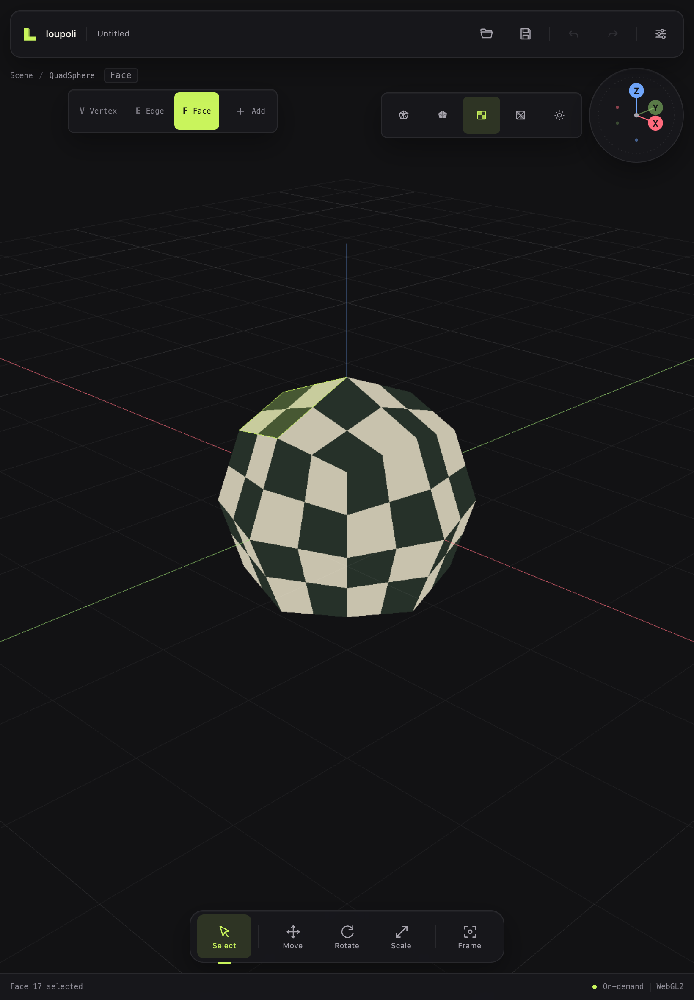

Global transform orientation for a child inside a rotated group:

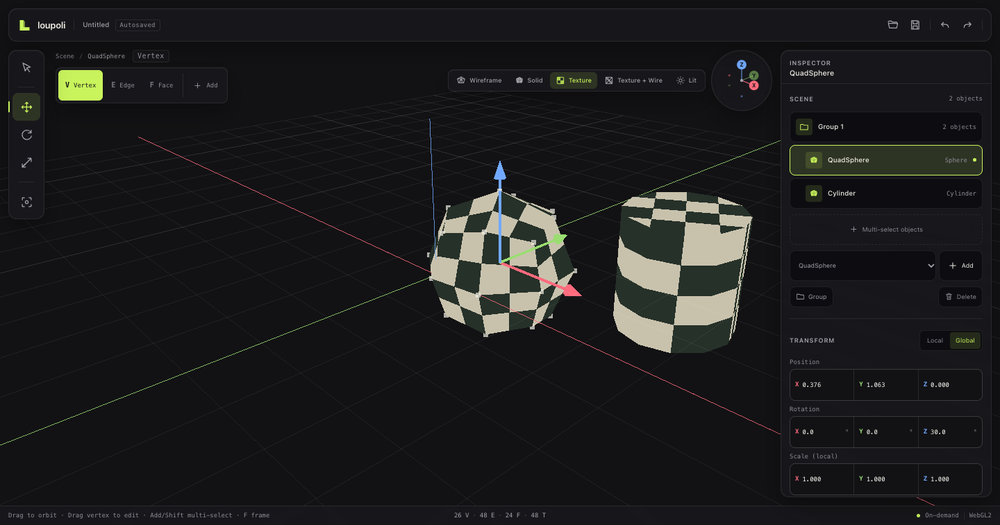

Modal move with an axis constraint and typed exact value:

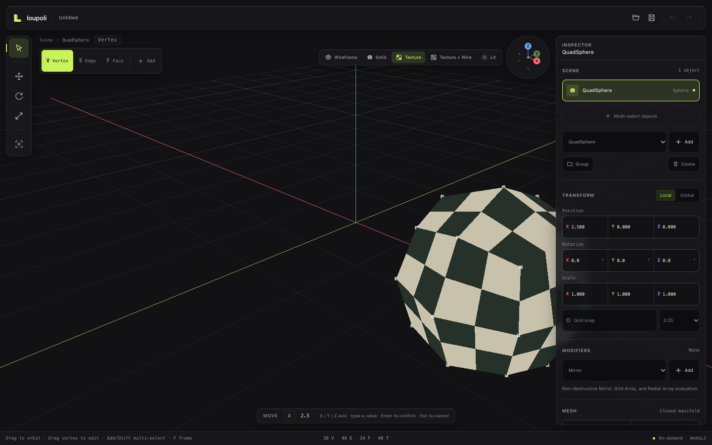

Context-sensitive element transform: face selection, local X constraint, exact 0.5 offset:

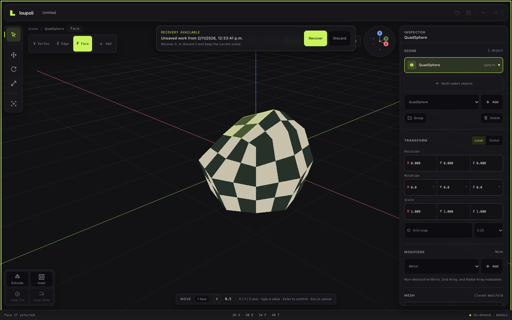

### Desktop modal transforms

- **G** starts a move of the selected elements, or of the active object/group when no elements are selected.
- **R** starts a rotation around the element median pivot, or around the object/group origin; without an axis it uses the view axis.
- **S** starts a uniform element/object scale, or one axis component when constrained.
- **X/Y/Z** constrain the operation. Press the same axis again to return to free mode.
- Typing a number switches to an exact preview. For a move, constrain an axis first; rotation values are degrees and scale values are factors.
- **Enter** or left click commits one undoable transform command. **Escape** or right click restores the previous pose.
- The HUD shows the operation, axis, value, and key hints.
- G/R/S act on the current element selection when one exists; otherwise they act on the active object or group.
- Vertex selections transform those vertices. Edge and face selections transform their unique vertices.
- Rotate and Scale use the median of the affected vertices as the pivot; Translate uses no pivot.
- Element transforms work on the base DCEL. With an active modifier stack they transform the selected base elements, target the base selection median, label the HUD with `(base)`, and re-evaluate all modifier copies. The operation is base-space, not evaluated-copy-space.
- Element changes use a localized vertex-transform command with one autosave patch per affected vertex. Selection remains active after commit. Mouse translation preserves the full inverse object-space delta rather than normalizing it.

### Selection gizmo

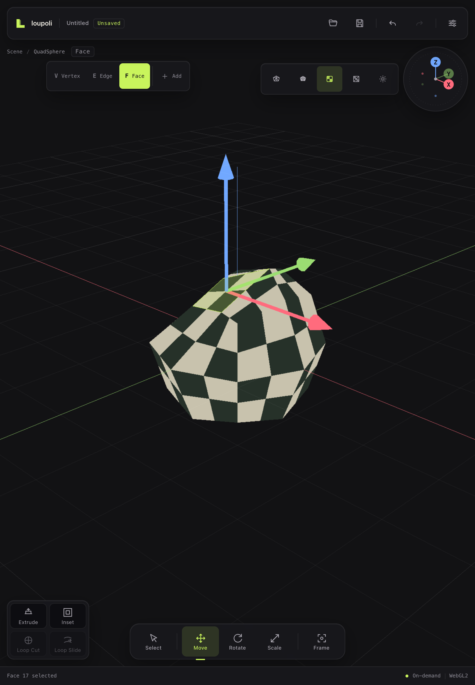

- Select vertices, edges, or faces first.
- Tap **Move**, **Rotate**, or **Scale** in the tool rail.
- The axis gizmo is placed at the median of the selected elements.
- Drag an X/Y/Z axis with the Pencil or mouse. Move and Scale also expose a center handle for free-plane movement and uniform scaling. The gizmo follows the live selection median during the drag; selection remains active after the commit.
- Local/Global orientation applies; modifiers operate in base space at the base-selection median.
- With no element selection, the same tools return to object/group transforms.
- One-finger touch still orbits rather than dragging the gizmo; use the Pencil or mouse.

### ActionDock

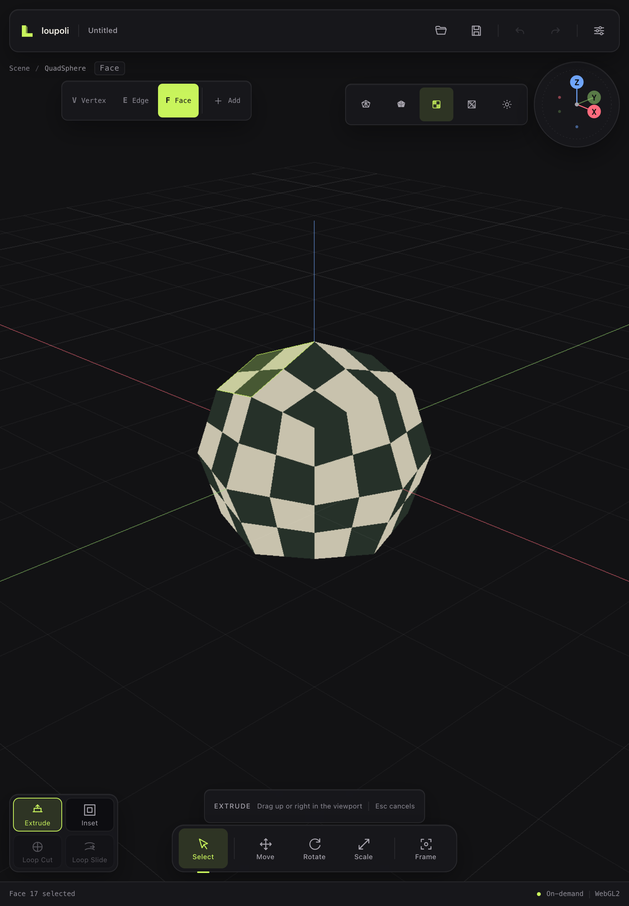

- Appears at the bottom-left when an object is active, on both touch and desktop layouts.
- **Extrude** requires one or more selected faces.
- **Inset** requires exactly one selected face.
- **Loop Cut** requires exactly one selected edge.
- **Loop Slide** becomes available after a loop cut and adjusts that most recent cut loop.
- Tap or click once to arm; the active button and HUD identify the action. Drag up or right in the viewport to increase the amount, then release to apply one undoable command. On desktop, type an exact amount and press Enter instead of dragging.
- Amounts are shown live: world units for extrude, percentages for inset and loop position.
- Desktop shortcuts: **E** extrude, **I** inset, **L** loop cut, **Shift+L** loop slide. The ActionDock remains visible for mouse use.
- **Esc** or tapping the active action again cancels an armed action; cancelling a drag restores both the mesh and selection.
- Loop Cut inserts a loop; Loop Slide re-cuts the retained original loop source at a new position. While adjusting, a blue loop-preview line marks the prospective cut. The last-loop context is restored through undo/redo of loop cuts and slides, and clears on unrelated edits. Undo, autosave mesh patches, and modifier evaluation apply normally.

Desktop action with an exact typed amount:

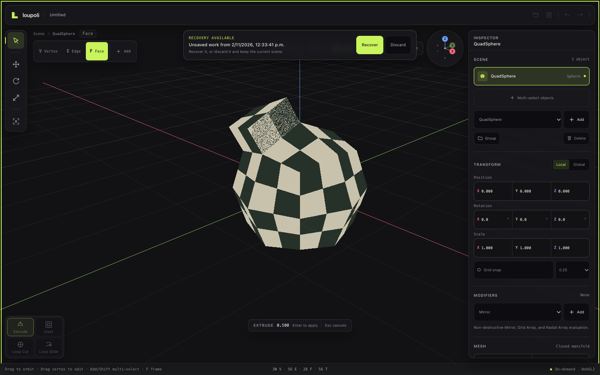

Loop Cut shows a blue prospective-loop line while the amount is adjusted:

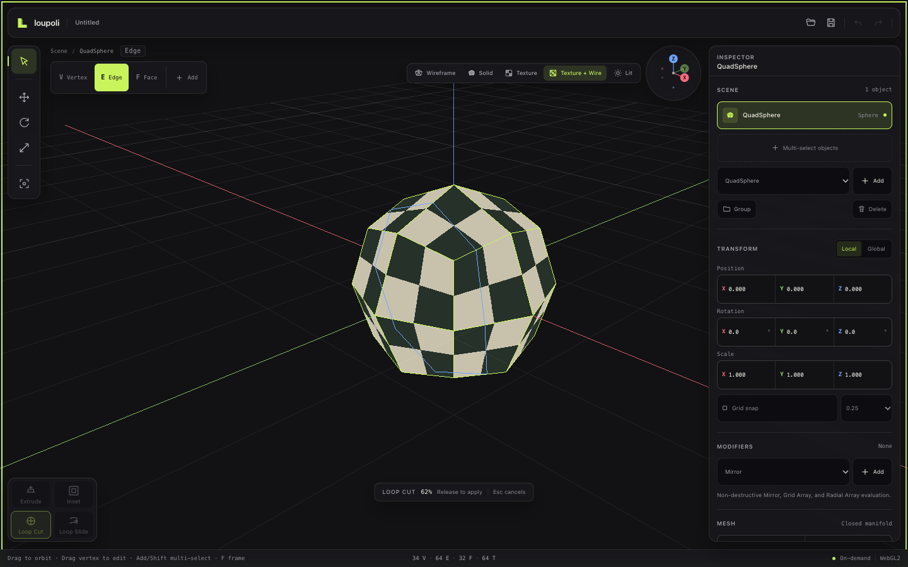

## iPad layout

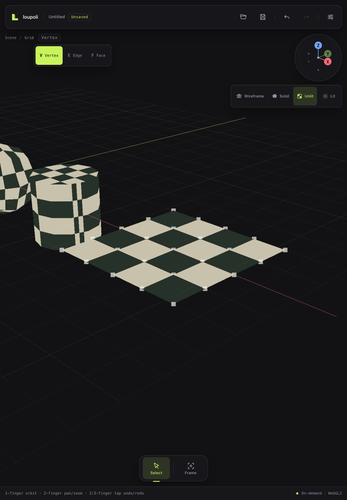

The same shell in iPad landscape, with the inspector docked:

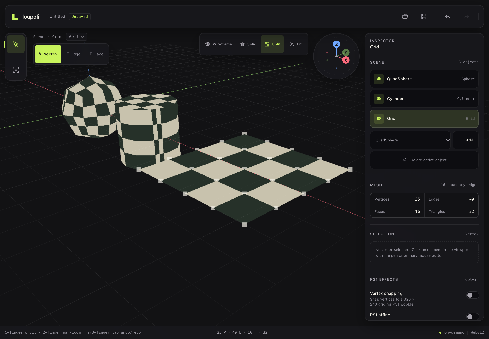

The iPad inspector is a non-modal bottom sheet: one-finger orbit still works above it, and the scene/primitive controls stay reachable. On desktop the inspector is a true right column, not an overlay.

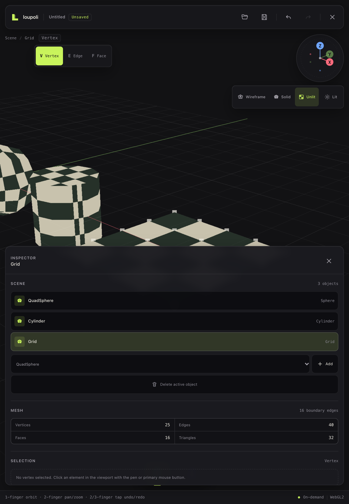

Target baseline: **iPadOS 16.4+**. The Tauri app is structured for iOS, but the iOS project has not been initialized or built: CocoaPods, Rust iOS targets, simulator runtimes, and physical-device signing are still missing. The iOS packaging and hardware validation pass comes next.

---

## License

loupoli's source is **source-available** under [PolyForm Noncommercial 1.0.0](https://polyformproject.org/licenses/noncommercial/1.0.0). It is not OSI open source, because the license does not permit commercial use. Personal, educational, research, and other noncommercial use is allowed. Commercial use and commercial derivatives require a separate written license; see [COMMERCIAL.md](COMMERCIAL.md). The full license text and the commercial and sample-asset notices are available inside the About dialog, so they remain readable without a working external browser.

The sample gorilla model and texture used for documentation screenshots are licensed under [CC BY 4.0](https://creativecommons.org/licenses/by/4.0/), not under PolyForm. See [ASSETS.md](ASSETS.md) for attribution and the list of covered files. 
## Planning and architecture

| Document | Contents |
|---|---|
| [Documentation index](docs/README.md) | Ownership, reading order, and maintenance rules for all docs |
| [Working Instructions](AGENTS.md) | Master rules, iOS memory constraints, transform/modifier rules, quality gates |
| [Master Plan](docs/PLAN.md) | Product constraints, approved decisions, phase exits, risks, toolchain audit |
| [Architecture](docs/ARCHITECTURE.md) | Runtime boundaries, DCEL, multi-node rendering, picking, autosave, file I/O |
| [Design System](docs/DESIGN_SYSTEM.md) | Tokens, visual direction, responsive editor layout, component inventory |
| [Persistence](docs/PERSISTENCE.md) | Implemented autosave journal, v4 texture/lighting checkpoints, and `.lpoli` v4 |

## Project layout

```text
src/
  design/            CSS tokens, base styles, canvas theme extraction
  lib/
    editor/          Runtime, rune session projection, history, scene commands
    geometry/        Generalized half-edge DCEL, QuadSphere/Cylinder/Grid, tests
    input/           Pointer-type router, camera gestures, touch tap recognizer
    platform/        Browser/Tauri project file adapters
    project/         `.lpoli` codec, autosave journal, IndexedDB service
    render/          WebGL2 viewport, per-node views, camera rig, materials
    scene/           MeshNode and SceneDocument
    ui/              Icons, primitives, chrome, inspector, recovery banner
src-tauri/           Tauri v2 shell, dialog plugin, Rust file commands
docs/                Planning, architecture, persistence, design system, media
```

## Approved decisions

1. Phase 1 establishes the real DCEL seed and vertex-move command.
2. Minimum target is iPadOS 16.4.
3. `.lpoli` textures will be stored as binary PNG chunks, not base64 strings.
4. Bundle identifier is `com.loupoli.studio`.
5. Correct perspective Unlit mapping with no vertex snapping is the default; PS1 effects are opt-in.
6. Non-planar quads use render-only bilinear tessellation; the editable DCEL remains quads.
7. `.lpoli` v4 is the development format: texture assets, per-layer PNG chunks, node bindings, and lighting. v3 files remain readable; legacy v1/v2 compatibility is deferred until the MVP build.
