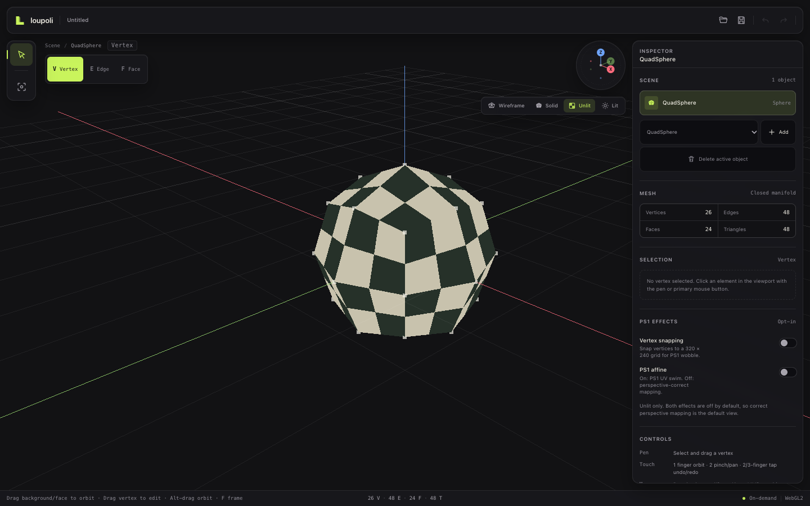

# loupoli

A low-poly, pen-first 3D modeling studio for iPad and desktop. Z-up, quad-centric, on-demand rendered, and local-first.

**Brand:** always lowercase `loupoli`.

**Status:** Phase 2 is implemented. Phase 3 is underway: multi-element selection with additive touch taps, one-level object groups, multi-object selection and join, object/group transforms and gizmos, view-gizmo orbit, destructive deletion, face extrusion and inset, vertex merge, a two-boundary-edge bridge, grid snapping, vertex axis locks, a collapsed PS1 module, and a provenance-mapped Mirror/Grid Array/Radial Array modifier stack with base topology actions are implemented. Loop bridging controls, loop cut, and direct base-vertex dragging under an active modifier stack follow.



---

## What works now

- **Z-up WebGL2 viewport.** `THREE.Object3D.DEFAULT_UP` is set once before scene construction; the custom grid lies on the XY plane.
- **On-demand rendering.** The scheduler draws only for camera, resize, document, selection, or shading invalidation. Headless Chrome measured a stable render count while idle.
- **Camera rig.** Orbit by dragging empty canvas, by Alt/Option-drag, by middle-mouse drag, or with one-finger touch. Two-finger touch pans/pinches, wheel zooms, and the orientation gizmo animates axis-aligned views. No damping loop.
- **Four shading modes.** Wireframe (true topological edges), Solid (flat-shaded clay), Unlit/PS1 (custom GLSL), and Lit (flat-shaded checker material).
- **PS1 is opt-in and tucked away.** Correct perspective mapping and unsnapped geometry are the default. The two independent effects live inside the collapsed **PS1 look** render-effect module at the bottom of the Inspector:
  - **Vertex snapping** — snap vertices to the 320 × 240 PS1 raster.
  - **PS1 affine** — enable affine UV swim.
  Both start off, apply only to Unlit shading, and the module starts collapsed. It is a render effect, not a geometry modifier.
- **General half-edge kernel.** Columnar DCEL with explicit face and boundary loops, per-corner UVs, per-edge seam flags, per-face materials, Newell normals, invariant validation, n-gon fan triangulation, and validated reconstruction from serialized columns.
- **Three real primitives.** QuadSphere (all quads), Cylinder (quad wall plus n-gon caps), and Grid (open surface with explicit boundary loops). The first-run scene contains an editable QuadSphere.
- **Multi-object scene.** Add primitives from the inspector, select the active object in the Scene outliner, delete it through an undoable command, and keep working with the same selection mode. New primitives are placed beside the existing scene rather than overlapping at the origin.
- **Numeric object transforms.** Position, rotation (degrees in the UI, radians in the document), and scale rows in the Inspector commit undoable `TransformNodeCommand`s. Transforms are local object transforms and persist in `.lpoly` and autosave deltas.
- **Object transform gizmos.** Move, Rotate, and Scale tools expose object-space handles on the canvas. Dragging an axis handle commits one axis-constrained `TransformNodeCommand`; mouse and pen are supported, while finger touch remains camera navigation. The gizmo maintains a constant screen size and follows the object's world position and orientation. A V/E/F control switches modes. Vertices and edges use the 16 CSS px screen-space tolerance with occlusion rejection; faces use a front-face raycast mapped back to the source DCEL face. Shift/Cmd/Ctrl-click, a sticky **Add** toggle, or additive one-finger touch taps build a set; clicking/tapping a selected element with Add toggles it out. A one-finger touch drag still orbits. Selected vertices, edges, and faces all render distinct overlays. Selection remains session state, not scene state.
- **Draggable view gizmo.** Dragging the orientation gizmo orbits the view; tapping an axis still snaps to that axis and tapping the center frames the active object.
- **Quad-aware deformation.** A bent quad renders as a 4 × 4 bilinear patch instead of two independent texture panels, avoiding a diagonal texture crease. The DCEL remains one quad, and displayed V/E/F/triangle counts stay topological.
- **Bounded command history.** Localized vertex deltas and node add/delete snapshots, redo truncation, a 100-command cap, and a 32 MB retained-byte budget.
- **Local-first autosave.** A checkpoint plus localized command deltas is written to IndexedDB every 30 seconds while dirty and on visibility loss. Cold start offers **Recover** or **Discard**; recovered work is labelled until saved.
- **Versioned `.lpoly` v1.** Binary container with a CRC-checked manifest and aligned typed-array columns. It round-trips multiple nodes, quads, n-gons, boundary loops, per-corner UVs, seam flags, face materials, transforms, and viewport settings.
- **Native and browser file I/O.** Tauri uses the native dialog plugin plus Rust byte-level read/write commands with size checks, same-directory temporary files, `fsync`, and rename. Browser mode uses download and file-picker fallbacks. `Cmd/Ctrl+S` and `Cmd/Ctrl+O` are wired.
- **Pointer routing.** Pen never moves the camera; it selects in the current mode and drags vertices. Touch remains the camera/gesture surface. Mouse supports the documented DCC orbit mappings.
- **Design system.** Vanilla CSS tokens, local icon registry, floating glass panels, responsive iPad portrait/touch layouts, 44 px touch targets, focus states, safe-area handling, and reduced-motion/reduced-transparency fallbacks.


Edge and face selection are real topology selections, not render-only triangles:


Additive multi-selection, using the sticky Add mode. Selected vertices, edges, and faces each get their own overlay:


Object transforms are available as local position, rotation, and scale fields with undo:


The Move tool's object-space gizmo. Rotate and Scale swap the handles for the same active object:


Deleting two faces creates real boundary loops; the PS1 render-effect module is collapsed by default:


Default and opt-in PS1 comparison, same camera position:


The autosave recovery flow is explicit and non-destructive:


---

## Getting started

Requirements: Node.js ≥ 22.12 (tested on 26.12), Rust ≥ 1.90 (tested on 1.94), npm, and macOS/Xcode for the Tauri desktop shell.

```bash
npm install
npm run dev          # browser development at http://localhost:1420
npm run tauri dev    # native desktop shell
npm run check        # svelte-check + strict TypeScript
npm run build        # production frontend
npm test             # DCEL, scene/history, journal, and .lpoly tests
```

Native file dialogs are provided by the Tauri dialog plugin; there is no second web server for browser mode. The iOS project has not been initialized yet.

### Controls

| Input | Action |
|---|---|
| Pen | Select a vertex, edge, or face in the current mode. In vertex mode, drag the selected vertex. Pen never moves the camera. |
| Mouse LMB on a topology element | Select it, or drag it in vertex mode. |
| Object row click | Make that object active. Shift/Cmd/Ctrl-click toggles multi-selection; the sticky **Multi-select objects** toggle does the same for pen/touch. |
| Group row click | Select the group for numeric or gizmo transforms. Group children stay editable from the indented outliner rows. |
| X/Y/Z while a vertex is selected | Toggle a world-axis lock for the next vertex drag. 44 px X/Y/Z chips provide the same control for pen/touch. |
| Grid snap toggle/step | Snap object translation and vertex drags to the selected 0.1–1.0 step. |
| Move/Rotate/Scale handle | Drag its X/Y/Z handle to transform the active object on that axis. Pen/mouse; finger touch remains camera navigation. |
| Shift/Cmd/Ctrl + click | Add or remove an element from the current selection. |
| Add toggle | Sticky additive selection for pen, mouse, and touch taps. |
| Touch tap / drag | One-finger tap selects the current V/E/F element; drag orbits. With Add on, taps toggle the set. |
| Mouse LMB on empty canvas or a mesh face away from a handle | Orbit the camera. |
| Alt/Option + LMB | Orbit. Useful for trackpads and one-button mice. |
| Alt/Option + Shift + LMB | Pan. |
| Mouse MMB | Orbit. |
| Shift + MMB | Pan. |
| Mouse wheel | Zoom. |
| One-finger touch | Orbit. |
| Two-finger touch | Pinch to zoom; drag to pan. |
| Two-finger tap | Undo. |
| Three-finger tap | Redo. |
| Cmd/Ctrl+Z | Undo. |
| Shift+Cmd/Ctrl+Z, Ctrl+Y | Redo. |
| Cmd/Ctrl+S | Save the project. |
| Cmd/Ctrl+O | Open a project. |
| F | Frame the active object. |
| Escape | Cancel the active drag, or close the mobile inspector. |
| Orientation gizmo | Drag to orbit the view; click an axis to align, or click the center to frame the active object. |

Selection modes are switched with the **Vertex / Edge / Face** control at the top-left of the viewport. The Scene outliner selects the active object; picking always edits that object.

---

## Verification performed

- `npm run check`: 0 errors, 0 warnings.
- `npm test`: 25 passing tests across five files:
  - DCEL invariants, outward winding, boundary loops, open-grid topology, and adaptive quad tessellation.
  - QuadSphere, Cylinder (n-gon caps), and Grid construction.
  - Localized vertex moves, add/delete commands, 100-edit history restoration, and the byte/command budget.
  - `.lpoly` multi-node round-trips (including open boundaries, seam flags, materials, and byte-for-byte re-encoding), corruption rejection, and empty-scene support.
  - Journal patch replay from a checkpoint, and a randomized 80-step add/delete/move/undo/redo sequence that validates every remaining mesh.
  - Scalar grid-snap rounding and axis-projection math.
  - Group creation/transform/ungroup undo and journal replay, plus group/parent round-trip through `.lpoly`.
  - Mirror clipping/winding/seam closure, grid repetition, radial repetition, modifier-stack persistence, stack edit journal replay, and evaluated-element provenance.
  - Single-face extrusion, multi-face region extrusion with boundary walls, and single-face inset closure/topology.
  - Face/vertex/edge deletion, boundary regeneration, UV/material preservation, delete-every-face rejection, and deletion command/journal replay.
  - Vertex merge to centroid, collapsed-face cleanup, two-boundary-edge bridging, and invalid-selection rejection.
  - Object join with transformed source baking, target pivot preservation, undo/redo, and multi-patch journal replay.
  - Multi-element selection replacement, additive toggling, duplicate suppression, pruning, and mode/node context clearing.
  - Object transform command execution, undo/redo, autosave journal replay, `.lpoly` transform persistence, and gizmo axis/angle/parameter math.
- `cargo test --manifest-path src-tauri/Cargo.toml`: 3 passing Rust tests for envelope/CRC validation, atomic project write/read, and missing-directory rejection.
- `npm run build` succeeds on Vite 8 / Svelte 5.
- `npx tauri build --debug --no-bundle` compiles the desktop shell, dialog plugin, and file commands.
- Headless Chrome WebGL2 smoke tests:
  - Desktop, iPad portrait, and iPad landscape layouts with no horizontal overflow.
  - Idle render count stable before/after a 1.2 s window.
  - Vertex, edge, and face picking; 16 px vertex threshold; single and multi-element overlays visible.
  - Multi-select via Shift-click and the sticky Add mode on both mouse and pen input; deselect-on-toggle and empty-click clearing verified.
  - Numeric position/rotation/scale commits, undo/redo, and orientation-gizmo drag orbit verified with a stable idle render count.
  - Move/Rotate/Scale gizmo handle picking and axis-constrained drags committed, undone, and verified on desktop and emulated iPad; all tool buttons remain 44 px+ targets.
  - Face, vertex, and edge deletion through the Selection panel and Delete/Backspace, with undo and live boundary-count update; no console errors.
  - PS1 effect module collapsed by default, expansion tested, and both toggles still function.
  - Merge selected vertices and bridge two boundary edges through the Selection panel, with undo and updated boundary counts.
  - Multi-object selection by modifier-click and the sticky toggle; joining sphere, grid, and cylinder objects into the active target, with validated topology and undo/redo.
  - Grid snap at 0.5 verified for object translation and vertex movement; Y/Z coordinates stayed untouched under X-axis lock; keyboard axis locking and 44 px iPad axis chips verified.
  - Grouped two objects, preserved their world centers, transformed the group numerically and with its gizmo, selected a child and edited its local position, then ungrouped with world centers preserved and undid it. Group tree rows/actions are 44 px on iPad.
  - Added, reordered, toggled, edited, and removed modifiers through the Inspector; evaluated counts updated live, reordering changed the result, invalid stacks surfaced errors, and all modifier controls are 44 px on iPad.
  - One-finger touch taps selected and toggled vertices with Add mode, multi-vertex overlays updated, empty taps cleared, and one-finger drag still orbited. Two/three-finger gesture paths remain unchanged.
  - Arrayed/mirrored picking mapped evaluated faces/vertices back to base indices; selected vertices highlighted on both array copies, selected faces highlighted on both copies, and disabling the modifier reduced the overlay to the single base element.
  - Extrude and Inset through the Selection panel; counts rose to 30 V/56 E/28 F after a single-face operation, multi-face extrusion reached 32 V/60 E/30 F, the rebuilt meshes validated, and both actions were 44 px targets.
  - With Grid Array active, deleted and extruded provenance-selected base faces: base/evaluated counts updated together, the stack stayed active, undo restored the base mesh, and no errors were logged.
  - Vertex drag through the real DCEL, undo, redo, and teardown without console errors.
  - Primitive creation, outliner selection, deletion, and undo/redo.
  - PS1 effects default off; enabling both produces snapping/UV swim.
  - Touch orbit while the non-modal iPad inspector is open.
  - Autosave flush, simulated reload, recovery banner, Recover/Discard, and structural (node add/delete) journal replay.
  - Browser save produced a valid `.lpoly`; browser open through a file input restored the saved two-node scene.
  - No application console warnings or exceptions.
- Screenshots in `docs/media/` were captured from the running app at the current UI revision.

Not yet verified:

- The native macOS WKWebView window has not been visually smoke-tested. The Rust shell and frontend production build are validated separately.
- Physical iPad performance, palm rejection, and native iOS file dialogs still require the iOS packaging pass.
- Browser cancel semantics depend on `input.cancel` or the window-focus fallback; Tauri uses its native dialog.

---

## Deliberately deferred

- Nested groups and rename/reparent controls beyond the current one-level groups.
- Direct base vertex dragging while the modifier stack is active (destructive topology actions and provenance selection work now).
- Loop cut and loop/multi-segment bridge controls; only single-face inset and exactly-two-boundary-edge bridging are implemented.
- Editable UV seams/unwrapping, texture layers, and projection painting.
- Scene lights UI, baking, shape keys/timeline, and OBJ/GLB import/export.
- Touch element dragging. Touch taps select; one-finger drag remains camera orbit.
- Camera state and active-object selection are not stored in `.lpoly` yet; node transforms and viewport settings are.

Phase 3 continues with loop/multi-segment bridging, loop cut, and direct base-vertex dragging under an active modifier stack. See the registered feature table in [PLAN.md](docs/PLAN.md#phase-3--object-mode-topology-editing-transforms-and-modifier-stack).

---

## iPad layout


The same shell in iPad landscape, with the inspector docked:


The iPad inspector is non-modal: one-finger orbit still works above the sheet, and the scene/primitive controls stay reachable.


Target baseline: **iPadOS 16.4+**. The Tauri app is structured for iOS, but the iOS project has not been initialized or built: CocoaPods, Rust iOS targets, simulator runtimes, and physical-device signing are still missing. The iOS packaging and hardware validation pass comes next.

---

## Planning and architecture

| Document | Contents |
|---|---|
| [Working Instructions](AGENTS.md) | Master rules, iOS memory constraints, transform/modifier rules, quality gates |
| [Master Plan](docs/PLAN.md) | Product constraints, approved decisions, phase exits, risks, toolchain audit |
| [Architecture](docs/ARCHITECTURE.md) | Runtime boundaries, DCEL, multi-node rendering, picking, autosave, file I/O |
| [Design System](docs/DESIGN_SYSTEM.md) | Tokens, visual direction, responsive editor layout, component inventory |
| [Persistence](docs/PERSISTENCE.md) | Implemented autosave journal and `.lpoly` v1 binary format |

## Project layout

```text
src/
  design/            CSS tokens, base styles, canvas theme extraction
  lib/
    editor/          Runtime, rune session projection, history, scene commands
    geometry/        Generalized half-edge DCEL, QuadSphere/Cylinder/Grid, tests
    input/           Pointer-type router, camera gestures, touch tap recognizer
    platform/        Browser/Tauri project file adapters
    project/         `.lpoly` codec, autosave journal, IndexedDB service
    render/          WebGL2 viewport, per-node views, camera rig, materials
    scene/           MeshNode and SceneDocument
    ui/              Icons, primitives, chrome, inspector, recovery banner
src-tauri/           Tauri v2 shell, dialog plugin, Rust file commands
docs/                Planning, architecture, persistence, design system, media
```

## Approved decisions

1. Phase 1 establishes the real DCEL seed and vertex-move command.
2. Minimum target is iPadOS 16.4.
3. `.lpoly` textures will be stored as binary PNG chunks, not base64 strings.
4. Bundle identifier is `com.loupoli.studio`.
5. Correct perspective Unlit mapping with no vertex snapping is the default; PS1 effects are opt-in.
6. Non-planar quads use render-only bilinear tessellation; the editable DCEL remains quads.
7. Phase 2 uses a versioned binary `.lpoly` v1 container with CRC validation, and an IndexedDB checkpoint-plus-deltas autosave journal.
