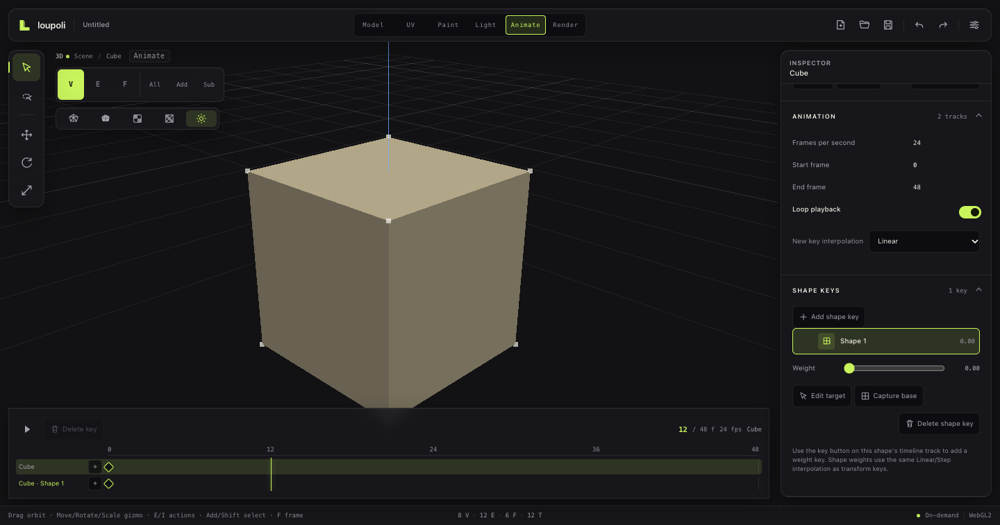

# Animation workspace

**Status:** Foundation implemented. The Animation workspace has transform tracks for objects and groups, keyframe insertion/deletion, linear/step interpolation, scrubbable timeline, and explicit scheduler-driven playback. Transform tracks and shape-weight tracks are implemented. Camera and light animation are not implemented yet.

## Model

Animation is document data:

```ts
interface AnimationTrack {
  id: string;
  targetId: string;
  targetKind: 'node' | 'group';
  keyframes: {
    frame: number;
    transform: NodeTransform;
    interpolation: 'step' | 'linear';
  }[];
}
```

- The project stores FPS, start/end frames, and tracks.
- Keys store complete transform values.
- The rest transform remains on the scene node/group.
- Playback applies a temporary **preview pose** through the renderer; it does not mutate or journal the rest transform.
- Key edits use one undoable `SetAnimationCommand` snapshot.
- Animation persists in `.lpoli` and participates in autosave recovery.

## Workspace

The `Animate` workspace is a 3D workspace with a bottom timeline.



- Scene outliner remains available for target selection.
- Inspector sections are ordered **Scene**, **Clip**, **Object animation**, **Modulators**, **Transform**, and **Selection**. Animate does not expose Mesh, Modifiers, or PS1 look, and it does not show the ActionDock. Shape keys are authored in Animate only and live inside **Object animation**.
- **Clip** owns the active clip name, FPS, start/end frame, loop, and default interpolation. **Object animation** owns the selected object's Mesh motion, Texture track, and Shape keys. **Modulators** is separate and collapsed by default.
- Animate always shows the timeline. Light and Render hide it by default; the top-bar **Timeline** toggle reveals it, and hiding it pauses playback.
- Timeline:
  - Play/pause
  - Scrubbable ruler
  - Tracks and key diamonds
  - Current frame and FPS
  - Adaptive ruler ticks
  - Minus/Fit/plus zoom; wheel pans and Ctrl/Cmd+wheel zooms
  - Selected-key interpolation editor
- The timeline sits above the status bar and uses the full width because Animate has no ActionDock. It shows an empty transform row for the active object/group and a weight row for every shape key, so the first transform and shape-weight keys are created in the timeline. Each row has a **+ Key** button. Selecting a diamond enables **Delete key**, Delete/Backspace, and an interpolation selector for that key. Diamonds can be dragged horizontally, snap to integer frames, and commit one undo step. Ruler ticks adapt to the visible range; minus/Fit/plus zoom, wheel panning, and Ctrl/Cmd+wheel zooming are available. Key insertion rounds to the exact frame. Transform edits show from the current animated pose; an existing key at the current frame updates automatically, while an unkeyed frame requires a timeline key.
- Clip Inspector:
  - Clip name
  - FPS, start/end frame
  - Loop toggle
  - Default interpolation for new keys; select a diamond to edit its existing interpolation in the timeline
- Object animation Inspector:
  - Mesh motion: Edit mesh pose, Finish/Cancel, key count
  - Texture: texture track and Key current
  - Shape keys: add/select/rename/weight/visibility/reorder, Edit target, Capture current mesh, Key weight, Delete
  - Shape-weight key deletion and interpolation stay in the timeline
- Modulators Inspector:
  - LFO, noise, audio-envelope, and camera-orbit modulators
  - Add, target, property, axis, amplitude, offset, and remove controls

## Playback rules

- A requestAnimationFrame loop runs **only while playing**.
- Pausing cancels the loop; idle remains zero frames.
- Scrubbing evaluates the pose immediately.
- Leaving the Animation workspace pauses playback; the preview pose is cleared except when moving into Render, where the current frame remains renderable.

## Current limitations

- Material tracks are not implemented.
- Keys are complete transforms; per-channel keying comes later.
