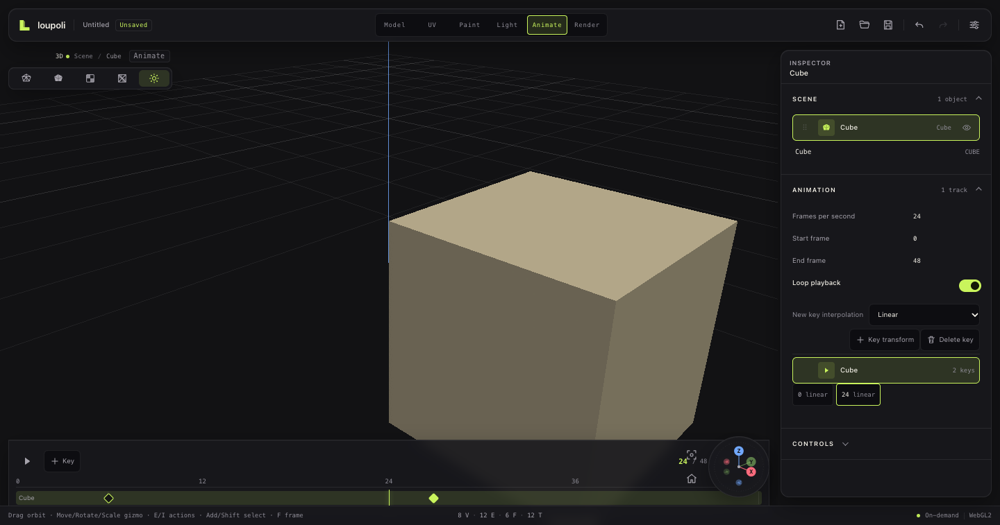

# Animation workspace

**Status:** Foundation implemented. The Animation workspace has transform tracks for objects and groups, keyframe insertion/deletion, linear/step interpolation, scrubbable timeline, and explicit scheduler-driven playback. Camera animation, light animation, and shape keys are not implemented yet.

## Model

Animation is document data:

```ts
interface AnimationTrack {
  id: string;
  targetId: string;
  targetKind: 'node' | 'group';
  keyframes: {
    frame: number;
    transform: NodeTransform;
    interpolation: 'step' | 'linear';
  }[];
}
```

- The project stores FPS, start/end frames, and tracks.
- Keys store complete transform values.
- The rest transform remains on the scene node/group.
- Playback applies a temporary **preview pose** through the renderer; it does not mutate or journal the rest transform.
- Key edits use one undoable `SetAnimationCommand` snapshot.
- Animation persists in `.lpoly` and participates in autosave recovery.

## Workspace

The `Animate` workspace is a 3D workspace with a bottom timeline.



- Scene outliner remains available for target selection.
- Inspector sections: **Scene**, **Animation**, **Controls**.
- Timeline:
  - Play/pause
  - Scrubbable ruler
  - Tracks and key diamonds
  - Current frame and FPS
- Animation Inspector:
  - FPS, start/end frame
  - Loop toggle
  - New-key interpolation
  - Key/delete key
  - Track list and key list

## Playback rules

- A requestAnimationFrame loop runs **only while playing**.
- Pausing cancels the loop; idle remains zero frames.
- Scrubbing evaluates the pose immediately.
- Leaving the Animation workspace pauses playback; the preview pose is cleared except when moving into Render, where the current frame remains renderable.

## Current limitations

- No camera tracks yet.
- No light or material tracks.
- No shape keys yet.
- Keys are complete transforms; per-channel keying comes later.
