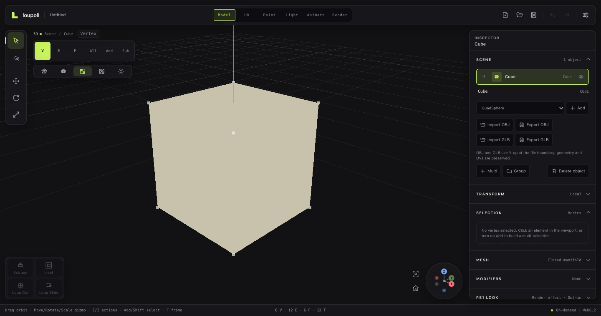

# OBJ and GLB interchange

**Status:** OBJ and GLB import/export are implemented with simple per-face material colors. Both imports are one undoable scene transaction. OBJ preserves quads/n-gons and UVs; GLB is triangulated by definition. OBJ export can target the active object or the whole scene and can include the assigned composite texture as a PNG beside the MTL. Both OBJ and GLB export the evaluated modifier result; GLB embeds assigned composite textures and is validated in Blender with indexed primitives and node TRS transforms.

## Coordinate boundary

- File formats use Y-up.
- loupoli uses Z-up.
- Import converts Y-up to app Z-up.
- Export converts app Z-up to Y-up.
- Imported objects are world-baked; glTF node transforms are flattened.

## OBJ

Implemented:

- `v`, `vt`, `f`, `o`/`g`, and `usemtl`
- Negative indices
- Quads and n-gons
- Per-corner UVs
- Simple `Kd` MTL diffuse colors
- Malformed-index validation
- Export with global OBJ vertex/UV indices
- Export of an `.obj` and `.mtl` bundle
- Source choice: active object or whole scene
- Optional composite texture export as a PNG referenced by `map_Kd`
- Browser ZIP or native folder bundle
- Evaluated modifier geometry at the current shape weights

Limitations:

- A browser import currently selects the OBJ file only; external MTL is not read automatically.
- External texture maps are not read on import; OBJ export writes the assigned composite texture only.
- Normal maps are not exported.
- Shape weights are baked when they are active in the evaluated result; OBJ does not retain morph targets.

## GLB

Implemented with Three's GLTF loader/exporter:

- Binary GLB import
- Triangles converted to validated DCEL topology
- Per-corner UVs and split seams preserved
- Material base colors become the node palette
- Multiple meshes import as separate nodes
- Binary GLB export with triangulated, indexed evaluated geometry and simple materials
- Embedded assigned composite textures as PNG bufferViews
- Y-up conversion at both boundaries
- Node TRS output and material names for broad DCC compatibility
- Scene cameras export as glTF perspective cameras
- Directional and point lights export with `KHR_lights_punctual`
- Camera/light animation exports as node position and rotation channels
- Exported evaluated, textured GLB opened successfully in Blender 5.1

Limitations:

- PBR material complexity is reduced to base color plus the assigned composite texture; roughness/metalness remain defaults.
- GLTF textures, skins, cameras, lights, and camera/light animation are not imported yet. Object and morph animations are imported. Morph targets import into shape keys and export as relative GLB morph targets with influences when exporting the unmodified base mesh.
- Camera FOV and light intensity are fixed in the GLB because glTF node animation cannot animate camera/light properties; the project file retains their full animation.
- Non-manifold GLB triangle soup is rejected with a clear error.
- Export uses the evaluated modifier mesh and simple per-face colors.
- GLB embeds the assigned composite texture; it does not yet export normal maps or a full material graph.
- Shape-key morph targets are preserved only when exporting the unmodified base mesh. With evaluated modifiers or active weights, GLB exports the current evaluated surface instead.

## Materials

The current simple material model is:

- A node owns a palette of hex colors.
- Every face references a palette index.
- Renderer geometry receives vertex colors from the face material.
- OBJ `Kd` and GLB base colors map into that palette.
- No material graph, roughness/metalness editor, or per-material texture is exposed yet.

## Import safety

- OBJ parser validates indices and requires polygon faces.
- GLB conversion catches DCEL validation failures and reports the source mesh.
- Imports use one `CompositeCommand`, so undo removes the entire imported batch.
- File picker/native import/export errors surface through both a toast and the persistent project error banner.
