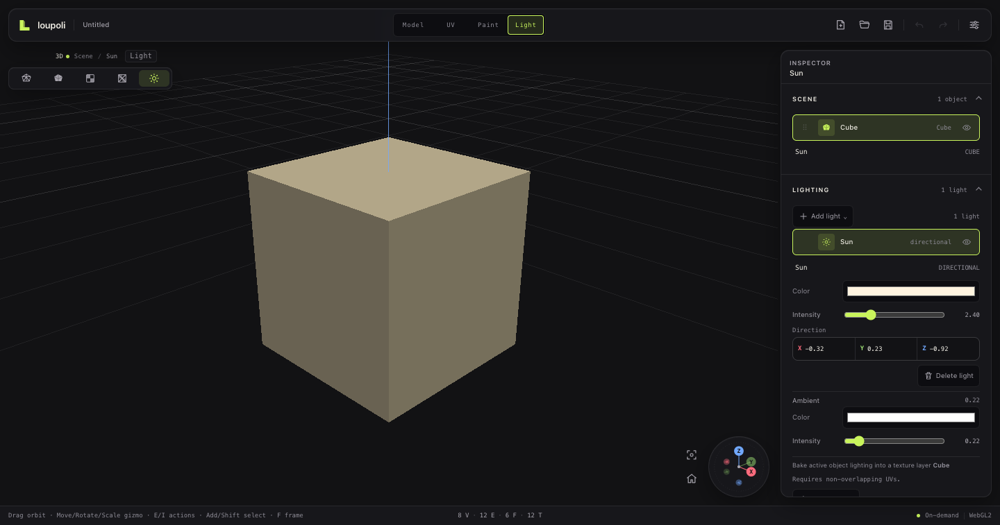
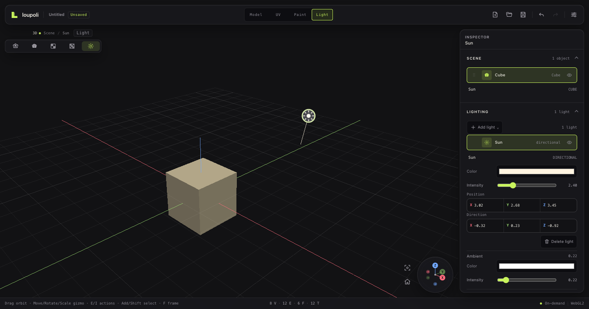
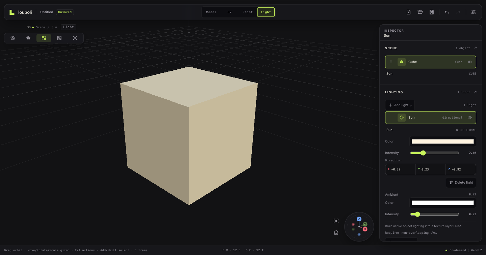
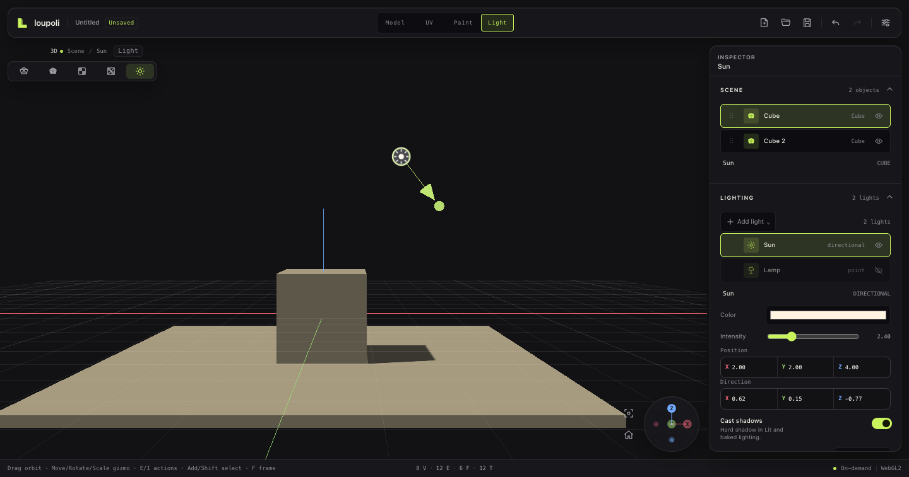
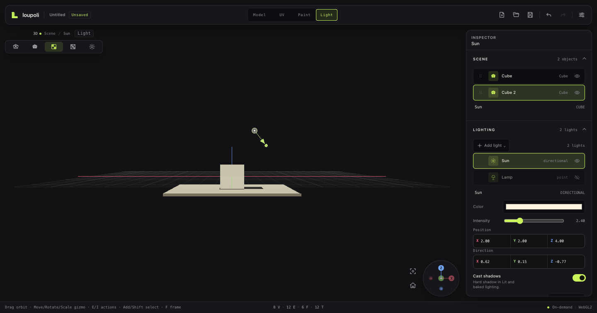
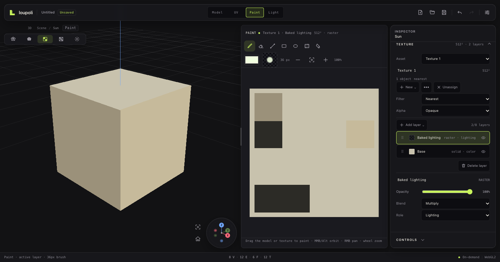

# Phase 5A — Lighting and texture bake

**Status:** Implemented. Direct-ambient/directional/point lighting, per-light hard shadows in Lit and the texture bake, Light workspace, Lit preview, and texture-layer bake are implemented. Soft shadows and AO are explicitly deferred.

**Goal:** Light a low-poly scene with a deliberately small model, preview it in `Lit`, then bake direct light into a dedicated texture lighting layer for final textured display.

## Contents

1. [Scope](#1-scope)
2. [Light model](#2-light-model)
3. [Light workspace](#3-light-workspace)
4. [Bake](#4-bake)
5. [Persistence](#5-persistence)
6. [Acceptance](#6-acceptance)
7. [Deferred](#7-deferred)

## 1. Scope

Supported:

- `directional` and `point` lights
- document ambient color/intensity
- enabled/disabled lights
- flat-shaded Lit preview
- per-light hard shadows in Lit and direct-light baking into a texture lighting layer

Not supported:

- soft/area shadows
- AO / contact shadows
- spot/area lights
- HDRI/IBL
- PBR
- GI
- light animation
- light linking

Solid keeps its fixed neutral viewport rig. Unlit/PS1 stays unlit. Lit uses document lights only.

## 2. Light model

Lights are document scene data, separate from DCEL mesh nodes:

```ts
type LightKind = 'directional' | 'point';

interface LightSnapshot {
  id: string;
  name: string;
  kind: LightKind;
  color: string;
  intensity: number;
  enabled: boolean;
  position: [number, number, number];  // point
  direction: [number, number, number]; // directional
}
```

New projects include a default `Sun`. Lights default to `castShadows: true`; the selected light has a **Cast shadows** switch. Ambient is document-level `ambientColor` + `ambientIntensity`.

Light creation, deletion, editing, and ambient changes are undoable commands with autosave journal patches.

## 3. Light workspace



Light markers show each light’s editor position in the viewport. Directional lights also show a cone-tipped direction arrow; their position is a marker anchor, while only their direction affects lighting. Point-light position affects lighting directly. Drag the marker to move a light, or drag the arrow tip to re-aim a directional light. Both edits commit as one undoable command. Markers are billboard sprites: click one to select it, drag it to move the light position, and press Escape while dragging to cancel. The Light workspace frames the active object together with every visible marker.



`Light` is a first-class workspace tab after `Paint`.

- 3D viewport with light markers
- Lit preview with hard shadow maps by default
- Tool Rail, Selection Bar, ActionDock, and mesh-edit Inspector sections are hidden
- Scene outliner remains available to choose the bake target object
- Lighting Inspector owns add/edit/delete and ambient controls
- Visibility uses the shared outliner eye
- Per-light **Cast shadows** switch controls both Lit and bake
- Light markers show position; directional markers add a cone-tipped direction arrow
- Marker drag updates position; arrow-tip drag updates direction; each is one undoable command
- Naming uses `InlineNameField`
- Actions use shared `ActionButton`/`ActionMenu` primitives

## 4. Bake





The bake writes **direct light** into a dedicated lighting layer:

```text
Base/color/detail layers
Baked lighting   role: lighting, blend: multiply
```

Algorithm:

1. Rasterize source faces into texture space.
2. Interpolate world position with flat face normals.
3. Evaluate ambient + directional + point lights.
4. For each shadow-enabled light, trace a hard ray through every visible scene mesh before adding its contribution.
5. Write a transparent-backed RGBA lighting image.
6. Commit one undoable `Bake lighting` command.

Safety rules:

- UV islands must not overlap. A per-face coverage raster rejects local overlaps even when total UV area is below 1.
- If the active object’s texture is shared, bake into a new unique texture copy and assign it to the object. Never silently modify another object’s atlas.
- If the texture has a free layer, reuse a `lighting` role layer; otherwise create `Baked lighting`.
- The bake switches the viewport to `Texture`/Unlit for inspection.
- Bake undo removes a newly created layer or restores prior layer pixels.
- Baking marks the texture dirty and forces a v4 checkpoint with PNG chunks.

Shadows are hard visibility tests against all visible scene meshes, including the active mesh. Soft shadows and AO are not evaluated in this pass.





## 5. Persistence

`.lpoly` v4 adds:

```json
{
  "lighting": {
    "ambientColor": "#ffffff",
    "ambientIntensity": 0.22,
    "lights": [ ... ]
  }
}
```

v3 files remain readable; they receive the default Sun because they predate the light model. Textures and the baked lighting layer continue to use binary PNG chunks.

## 6. Acceptance

- Directional/point/ambient light data round-trips.
- Light edits are undoable and journaled.
- Light workspace is separate from Paint.
- Lit preview responds to document lights.
- Baking into an unwrapped object writes a multiply lighting layer with hard shadows from visible scene geometry.
- Baking a shared texture creates a unique copy and reassigns only the active object.
- Bake undo/redo restores layer and texture assignment state.
- Overlapping UVs are rejected with an actionable error.
- Idle rendering remains on-demand.

## 7. Deferred

- Soft shadows / AO
- Shadow progress/cancel UI beyond the busy state
- Physical-iPad performance and memory validation
- Shape keys, animation, import/export (Phase 5B–5C)
