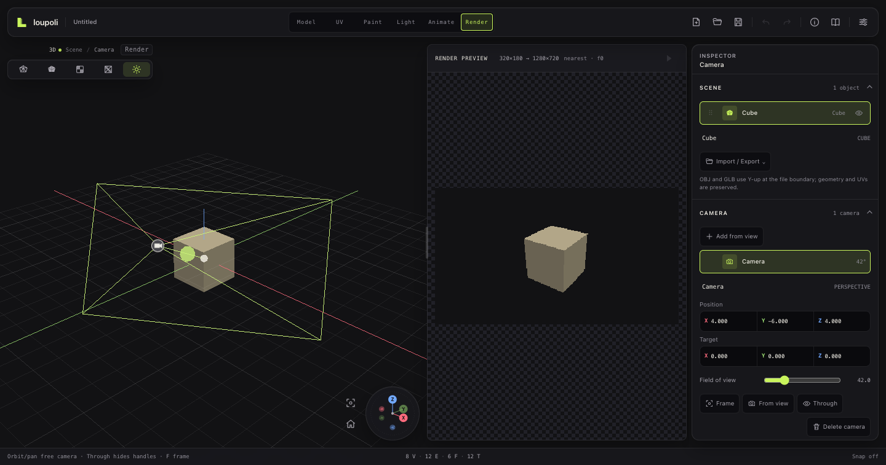
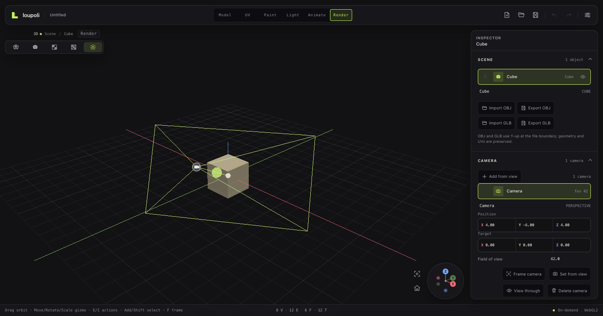
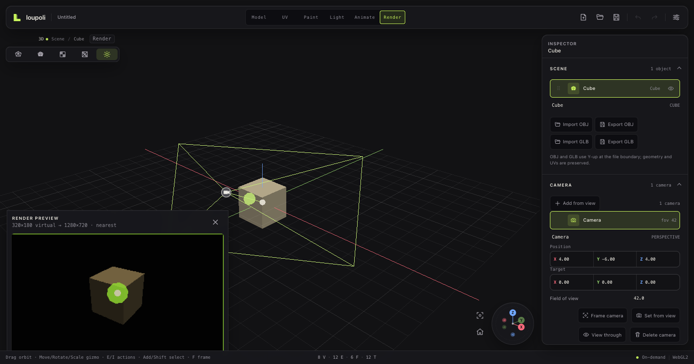

# Render workspace and camera

**Status:** Camera and render foundation implemented. Scene cameras, camera-driven preview, virtual/output resolution, nearest/smooth upscaling, PNG stills, deterministic PNG frame sequences, and WebM/MP4 recording where the WebView supports the codec are implemented.

## Contents

1. [Camera](#1-camera)
2. [Render workspace](#2-render-workspace)
3. [Virtual resolution](#3-virtual-resolution)
4. [Still output](#4-still-output)
5. [Video and sequences](#5-video-and-sequences)
6. [Next](#6-next)

## 1. Camera

Cameras are document objects, not session state:

```ts
interface CameraSnapshot {
  id: string;
  name: string;
  position: [number, number, number];
  target: [number, number, number];
  fov: number;
}
```

- Cameras are saved in `.lpoly`.
- The Camera Inspector lists cameras and exposes name, position, target, and field of view.
- **Add from view** captures the current navigation camera.
- The Render workspace can look through the active camera via **View through**, then return to free editing by orbiting. Editing the camera does not force the viewport back to the camera view.
- The Render workspace is a free camera-editing view with orbit, pan, zoom, the orientation gizmo, and a camera marker/frustum. Drag the camera body to move it, drag the target/arrow handle to re-aim it, or use Camera Inspector actions: **Frame camera**, **Set from view**, and **View through**.
- **Preview** renders the virtual-resolution frame, upscales it to the output size, and shows it in a floating preview portal before export.
- Camera animation tracks will be added with the animation timeline.

## 2. Render workspace

`Render` is a dedicated workspace after Light. It removes modeling chrome and the grid, leaving a camera-composition view.







Inspector sections:

- **Scene**
- **Camera**
- **Render**
- **Controls**

The render path is separate from the interactive viewport state:

- Clean scene: no grid, gizmos, selection overlays, handles, or light markers
- Explicit `PerspectiveCamera` built from the document camera
- Offscreen WebGL render target
- Still render through the active camera
- The viewport is restored after rendering

## 3. Virtual resolution

Virtual resolution is the internal render size; output resolution is the saved image size.

```text
render target: 320 × 180
output:       1280 × 720
upscale:      4× nearest
```

- Explicit virtual width/height and output width/height
- Nearest-neighbor or smooth upscaling
- Render size is independent of viewport CSS size and device pixel ratio
- Output can equal virtual resolution
- Transparent PNG background or a solid color
- Shading: Lit with realtime shadows, Texture/baked, or Solid

## 4. Still output

The still path:

1. Capture the active camera.
2. Render a clean frame at virtual resolution.
3. Flip readback into `ImageData` order.
4. Upscale into the output canvas.
5. Encode PNG.
6. Save through the native dialog or browser download.

Rendered focus shadows are baked by the renderer's current light state; baked lighting remains a static-texture result.

## 5. Video and sequences

- **PNG frame sequence:** renders each frame at the exact animation time, upscales it, and saves a folder on native platforms or a ZIP in the browser. Verified with a 64×36 sequence and valid PNG entries.
- **WebM:** uses `MediaRecorder` on a canvas capture and is enabled only when the WebView reports support.
- **MP4:** also uses `MediaRecorder` when the WebView supports an MP4 codec; otherwise the UI omits it and points to WebM/frames. Native AVFoundation encoding remains the reliable path for iPad production.
- Video rendering is real-time driven by the animation FPS; it is not a production-grade offline encoder yet.
- The Frame range is explicit and separate from the animation range.

## 6. Next

- Camera animation tracks
- Native iPad/macOS MP4 encoder
- Render progress/cancel UI and progress reporting

AO remains deferred. Hard/soft shadows are already bakeable.
