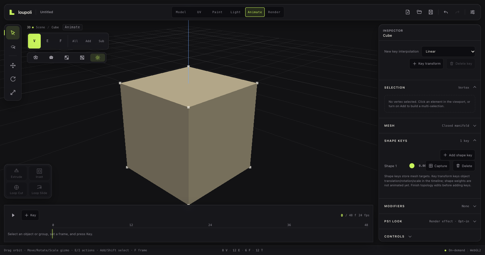

# Shape keys

**Status:** Minimal shape-key support implemented. Keys store absolute morph positions, expose weights, evaluate into the rendered mesh, persist as binary payload, and import glTF morph targets. Shape-key weight animation and sculpt-style key editing are not implemented yet. GLB morph import and export are implemented.

## Model

```ts
interface ShapeKey {
  id: string;
  name: string;
  weight: number;              // 0–1
  targetPositions: Float32Array; // absolute, same vertex order as the base mesh
}
```

- The base DCEL remains the editable topology.
- The evaluated mesh is `base + Σ(weight × (target − base))`.
- Modifiers evaluate on top of the shape-key result.
- Vertex indices and UVs are unchanged, so selection and picking remain valid.

## UI

Animate Inspector → **Shape keys**:

- Add shape key
- Weight slider per key
- Capture: stores the edited base mesh as the key target, restores the original base, and sets weight to 1
- Delete key



## Undo and persistence

- Adding/removing/weighting/updating keys uses one undoable `SetShapeKeysCommand`.
- Shape-key edits are journaled through `set-shape-keys`.
- Shape-key target positions are stored as aligned Float32 payload per node, not JSON arrays.
- Autosave checkpoints preserve them.

## Topology guard

Changing the node mesh through the topology command path throws:

> Remove shape keys before changing topology.

This prevents stale per-vertex morph targets. Direct vertex dragging is allowed while authoring: edit the base mesh in Animate, then press **Capture** to store that edit as the current key and restore the source base. Finish topology edits before adding keys.

## glTF

GLB import maps `morphAttributes.position` and morph influence weights into shape keys. GLB export writes shape keys as relative morph targets, with weights preserved as morph influences. A browser round-trip verified that a keyed +1 vertex deformation survives export/import at weight 0.5.

## Remaining

- Shape-key weight tracks in the animation timeline
- Sculpt/edit-shape mode
- Shape-key-aware topology editing or conversion
